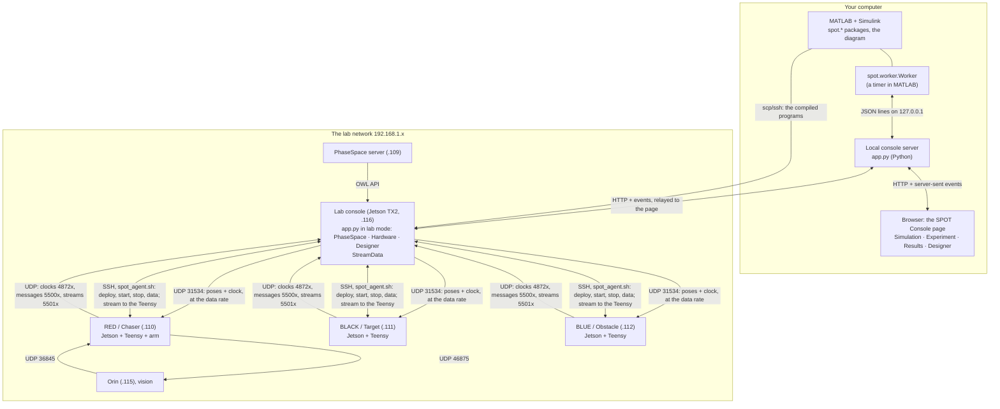

# How It Fits Together

SPOT is four kinds of computer and the programs that connect them. This page is the map; every box links to the pages that describe it.

## The pieces

**MATLAB** holds the truth: the settings struct ([[Settings File|Settings-File]]), the diagram, the simulations, the saved data. Everything the console shows is computed by a `spot.*` function ([[the packages|Project-Folder]]), so it all works without the console too ([[Getting Started|Getting-Started]] §Running without the GUI in the tutorial). `SPOT` starts the console: [[spot.console.start|spot-console-start]] launches the Python server and a [[Worker|spot-worker-Worker]] timer that connects MATLAB to it over a local socket and answers the page's commands (`settings.set`, `sim.run`, `data.series`, …; the list is in [[local.py|Console-local]]).

**The local console server** (`+spot/+console/webapp/app.py`, [[Console-Server]]) is a plain-Python HTTP server (no packages to install). It serves the page, forwards its requests to MATLAB, pushes events to the page (MATLAB's status, a simulation's progress, live samples), runs long jobs in the background ([[local.py|Console-local]]), and keeps a **link to the lab console** when the lab network is reachable: it polls `/api/state`, relays the lab console's event stream to the page, and forwards the Experiment tab's actions. Its address is a random port on `127.0.0.1` with a session **token**, so only the browser tab MATLAB opened can drive your MATLAB.

**The page** ([[index.html and app.js|Page-app-js]]): one HTML page, ES modules, three.js for the 3D table ([[viewer.js|Page-viewer-js]]). Which tabs it shows depends on which server it is talking to: the local one gives Simulation, Experiment, Results, Designer and Calibration; the lab one gives PhaseSpace, Hardware, Designer and Calibration ([[calibration.js|Page-calibration-js]]).

**The lab console** is the same `app.py` running on the Jetson TX2 in **lab mode** ([[Console-Server]], [[deploy scripts|Hardware-Deploy-Scripts]]). It compiles and runs [[StreamData|Hardware-StreamData]], which turns PhaseSpace's LED tracking into the pose packets the platforms consume ([[phasespace.py|Console-phasespace]]); it drives the platforms' Teensies for the Hardware tab and [[Interactive Mode|Interactive-Mode]] ([[hardware.py|Console-hardware]], [[interactive.py|Console-interactive]], [[control.py|Console-control]]); and it runs experiments: deploys the programs MATLAB built, starts them together, collects their data ([[experiment.py|Console-experiment]]); and it runs the lab's calibrations (the table's slope, the thrusters, the arm's friction on the Chaser) and keeps their results, which each project copies for its simulations ([[calibration.py|Console-calibration]], [[calfit.py|Console-calfit]]). It never needs MATLAB. Its page is `http://192.168.1.116:8080`.

**The platforms** each run a Jetson (Ubuntu) with the compiled diagram, which reads the PhaseSpace packets ([[spot.hardware.phasespaceLatest|spot-hardware-phasespaceLatest]]), computes the control, and writes the thruster packet to a **Teensy** over USB serial ([[teensy_pwm_control.ino|Hardware-Teensy-Firmware]]); the Chaser's Jetson also drives the arm's **Dynamixel** servos ([[spot.hardware.ArmTorque|spot-hardware-ArmTorque]]). A small shell agent ([[spot_agent.sh|Hardware-Deploy-Scripts]]) lets the lab console manage them over SSH with a restricted key.

## One diagram, two runs

The Simulink diagram ([[Diagram-Overview]]) is the same file in both cases. In a **simulation** MATLAB runs it with `simMode = 1`: the plant is integrated in the diagram, the clock is Simulink's, the hardware blocks are inert, and the results land in the workspace. For an **experiment**, [[spot.experiment.build|spot-experiment-build]] generates C code for each selected platform with `simMode = 0` (and `WhoAmI` found at run time), compiles it on the TX2 and leaves the `.elf` there; the lab console deploys it. The control code you write runs unchanged in both.

## Where the data flows during an experiment

1. **StreamData** on the TX2 sends every platform a packet at the data rate (positions, velocities, LEDs, and the experiment clock slot).
2. Each platform's program sends its own clock back (UDP 48720–48722). When the lab console has heard all of them, it arms the clock in the stream (`exp start 3`); three seconds later every program leaves phase 0 at the same instant ([[Diagram-PhaseSpace-Camera-Code]]).
3. Each program sends its debug message (55001–55003) and its live streams (55011–55013) to the lab console, which forwards them to the Experiment tab's Messages panel and Live Plot.
4. Each program logs its 108 signals to its `ExpLog` file. After **Stop**, **Collect** fetches them to the lab console, then to your `Saved Data/` folder, where MATLAB decodes them ([[Logged Signals|Logged-Signals]]).

## Ports and addresses

| Who | Address / port | What |
|---|---|---|
| Lab console page and API | `192.168.1.116:8080` | HTTP; `/api/events` is the event stream |
| PhaseSpace server | `192.168.1.109` | the OWL API (StreamData connects to it) |
| StreamData → platforms | UDP 31535 → 31534 | 115 floats: poses, velocities, LEDs, clock |
| StreamData → lab console | UDP (the viewer port) | the same packet, for the 3D view |
| Platforms → lab console | UDP 48720 / 48721 / 48722 | experiment clocks (RED / BLACK / BLUE) |
| | UDP 55001 / 55002 / 55003 | debug messages |
| | UDP 55011 / 55012 / 55013 | live streams |
| Platforms → network | UDP 33001–33003 broadcast | heartbeats ([[Check Connection|Diagram-Outgoing-Links]]) |
| RED ↔ Orin | UDP 46875 / 36845 | states out, vision estimate in |
| Lab console → platforms | SSH 22 (`spot_agent.sh`) | deploy, start, stop, status, data, Teensy stream |
| Local console | `127.0.0.1:<random>` + token | the page; the worker's socket is another random port |

All addresses are settings or constants in one place each: the lab console's in the settings (`labConsoleAddress`, compiled into the programs as `labConsoleIP`), the platforms' in `spot_console/platforms` configuration on the lab console, the fixed ones in [[spot.hardware|spot-hardware]]'s blocks and [[Console-experiment]].

## The files a project keeps

| File / folder | What | Written by |
|---|---|---|
| `spot_settings.json` | every setting of the Simulation tab | the console, on every change ([[Settings File|Settings-File]]) |
| `spot_design.json` | what is mounted on each platform | the Designer |
| `SPOT_User_Parameters.m` | your own workspace variables | you |
| `resources/spot_calibration.json` (optional) | the project's copy of the lab's calibration (the table's slope, each thruster's thrust, the arm's joint friction and inertia; a `resources/arm_calibration.json` from `calibrate_arm.py` still works, and the newer of the two arm calibrations is used) | the Calibration tab's Update ([[Calibration Tab|Calibration-Tab]]) |
| `Saved Data/<run>/` | saved simulations and collected experiments | Save Results, Collect |
| `.spot_cache/` | the console's port and token, the last simulation's replay, logs | the console (not to be committed) |
| `~/ExperimentSoftware/MATLAB_ws`, `~/ExperimentData` (on the TX2) | the compiled programs; collected runs | the build, Collect |
| `~/.spot_calibration.json` (on the TX2) | the lab's calibration | the Calibration tab's runs |
