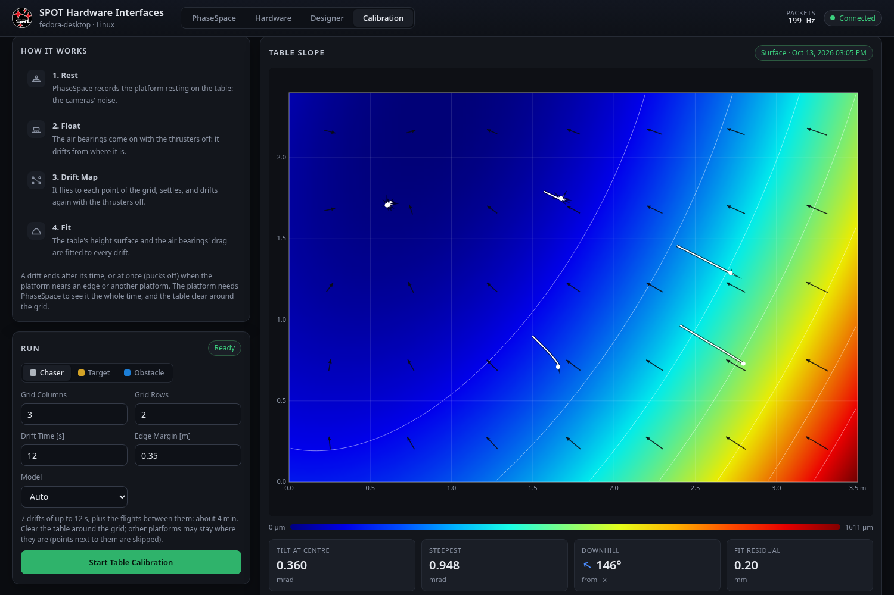
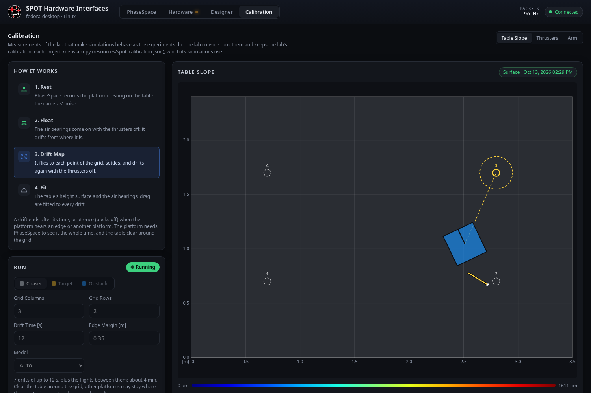
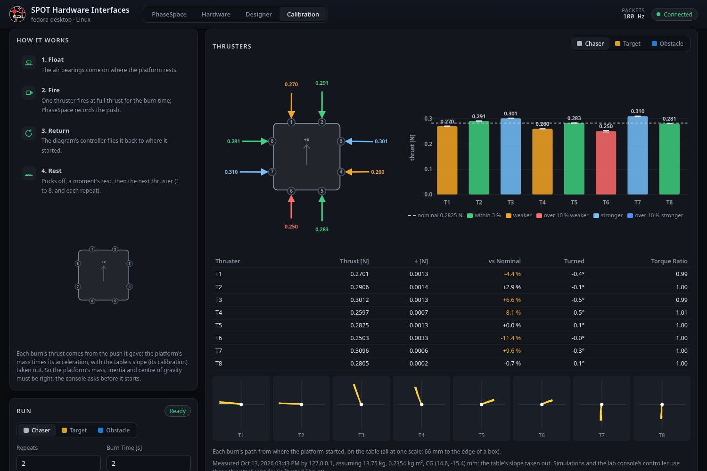
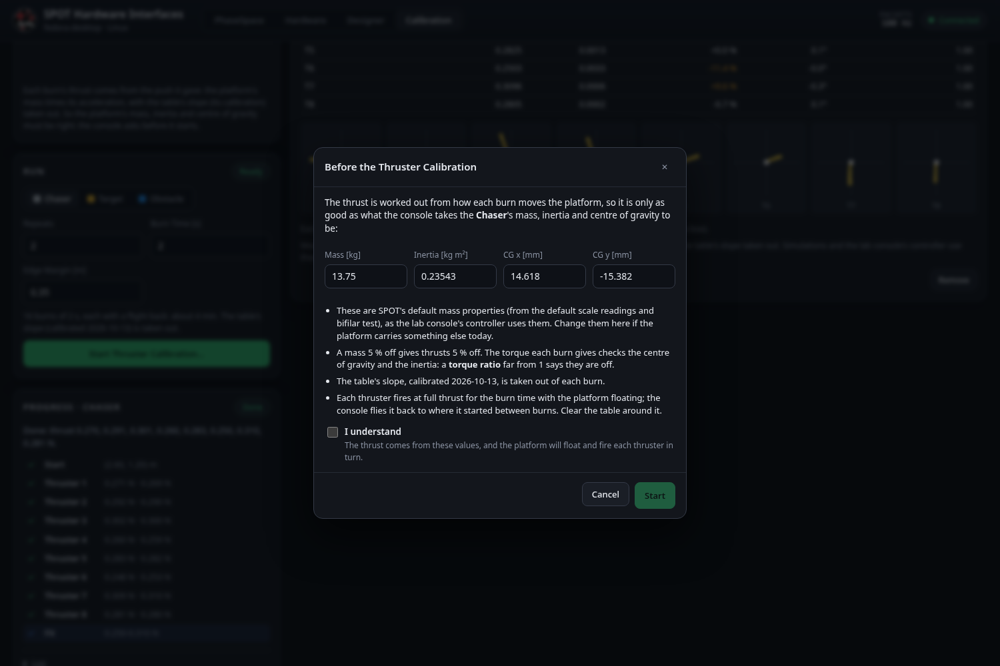
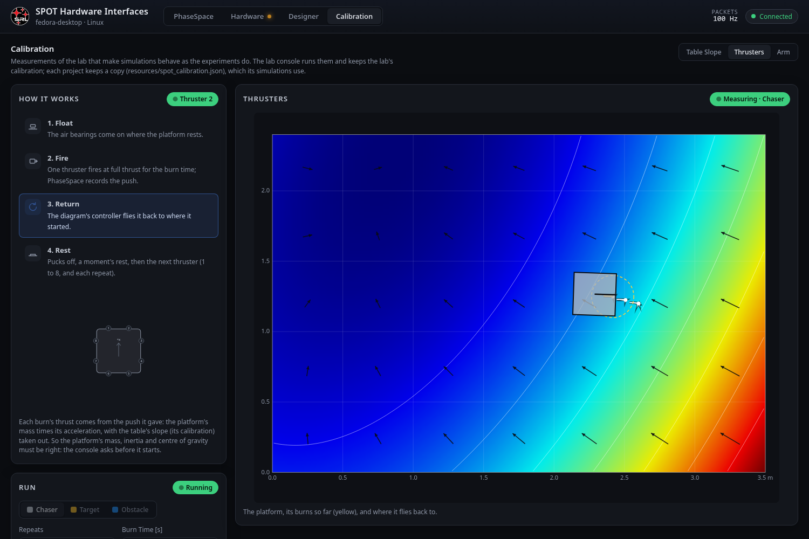
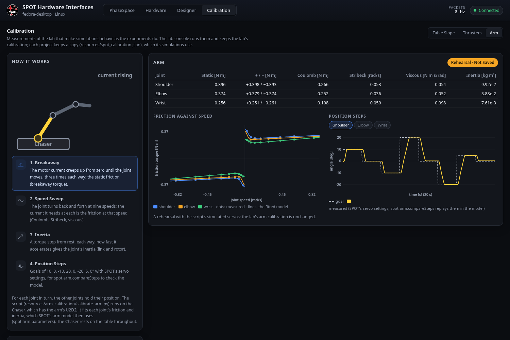
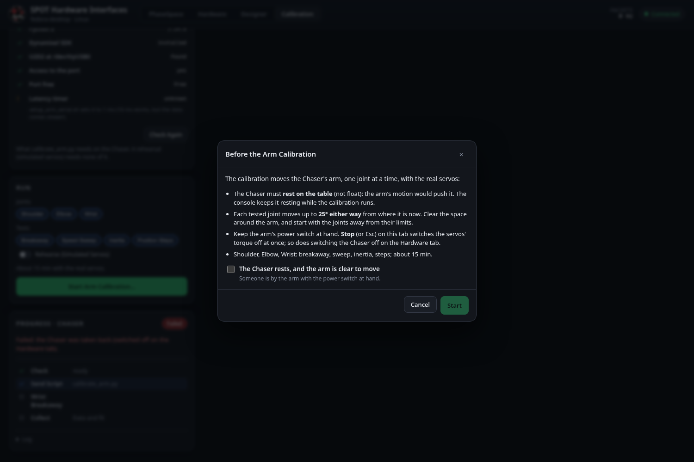
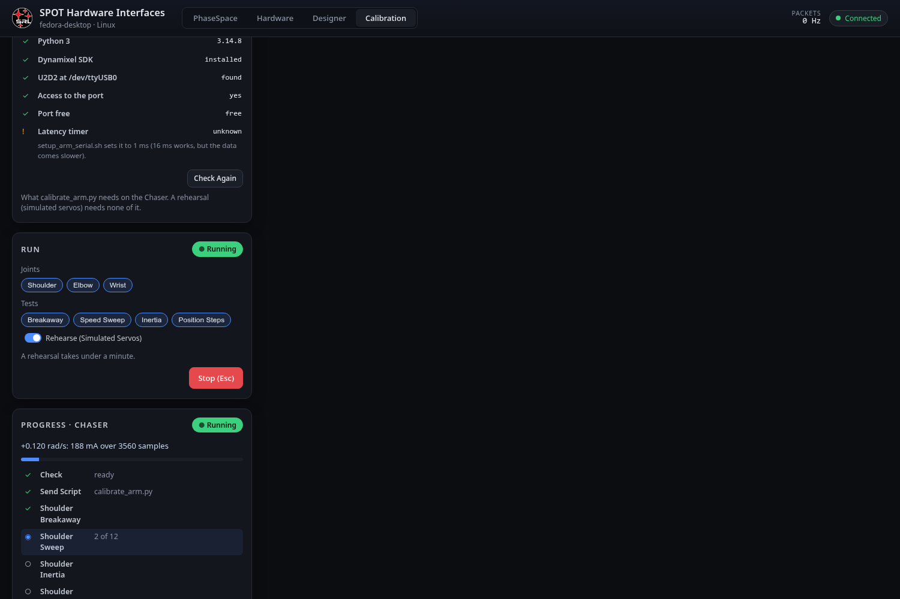
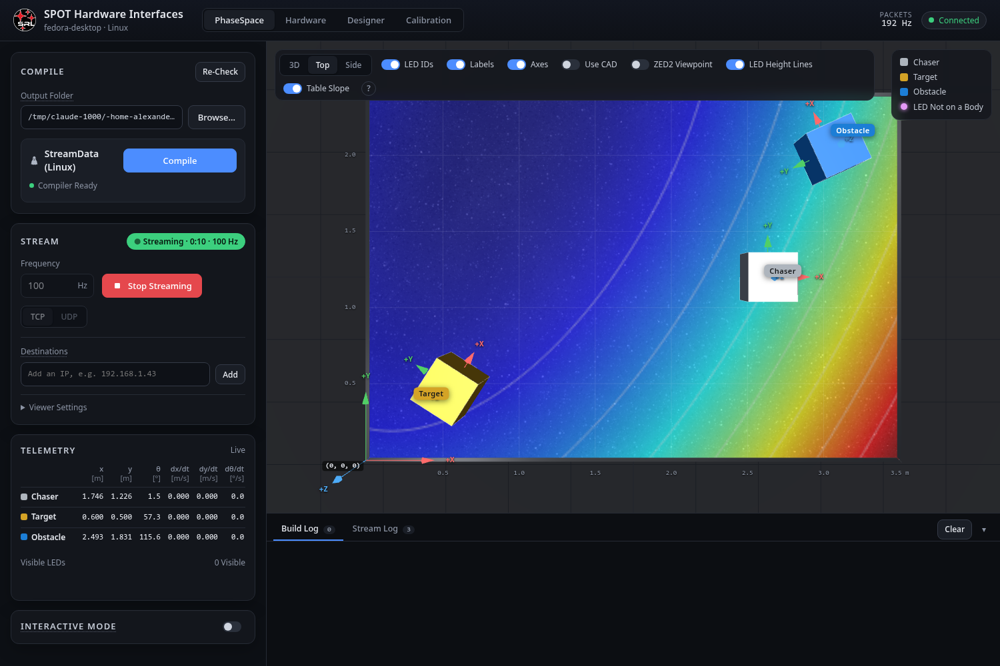
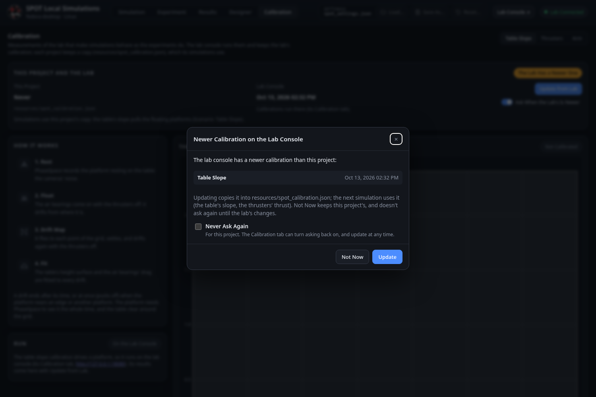

# Calibration Tab

Measurements of the lab that make simulations behave as the experiments do. The **lab console** (the TX2) runs them and keeps the lab's calibration; each **project** keeps a copy, `resources/spot_calibration.json`, which its simulations use. Code: [[calibration.py|Console-calibration]] and [[calfit.py|Console-calfit]] (server), [[calibration.js and calviz.js|Page-calibration-js]] (page); the maths is on [[The Calibration Fits|Math-Calibration]].

Three calibrations, chosen at the top right:

| | What it measures | Used by the simulation |
|---|---|---|
| **Table Slope** | The table top's height surface (it isn't perfectly level) and each platform's air-bearing drag | The floating platforms slide downhill ([[spot.sim.tableSlope|spot-sim-tableSlope]]) |
| **Thrusters** | Each thruster's real thrust, which way it pushes, and a check of the platform's assumed CG and inertia | The mixer and the simulated plant use each thruster's thrust; so does the lab console's controller (Interactive Mode) |
| **Arm** | Each joint's friction (breakaway, against speed) and inertia, with the real servos ([[calibrate_arm.py|Tool-calibrate-arm]], run on the Chaser) | The simulated arm's friction and inertia (Scenario: Calibrated Arm) |

## Table Slope

**How It Works.** With PhaseSpace streaming and the platform resting on the table:

1. **Rest.** PhaseSpace records the platform resting for 2 s: the cameras' noise.
2. **Float.** The air bearings come on with the thrusters off: it drifts from where it is.
3. **Drift Map.** It flies (the diagram's own controller, as [[Interactive Mode|Interactive-Mode]]) to each point of a grid over the table, settles, and drifts again with the thrusters off.
4. **Fit.** The table's height surface and the air bearings' drag are fitted to every drift, and saved in the lab's calibration.

A drift ends after its time, or **at once (pucks off)** when the platform's centre comes within the edge margin of an edge, within 0.45 m of another platform, or goes faster than 0.15 m/s; the platform then stops on its pucks. Grid points next to other platforms (or whose path passes them) are skipped, so the other platforms may stay where they are.

**Run** (lab console): the platform, the grid (columns × rows), the drift time, the edge margin and the model (**Auto**, **Surface**, **Plane**), then **Start Table Calibration** (only while PhaseSpace streams). The default 3 × 2 grid with 12 s drifts takes about 4 minutes. **Stop** (or Esc on this tab) ends it at once with everything off; so does Esc or switching the platform off on the [[Hardware tab|Lab-Console-Hardware-Tab]], where the platform shows as *Calibrating* while it runs.

While it runs, the map shows the grid (the point under way in yellow), the drifts so far, the platform and its goal, and the steps tick off on the left.

**The result.** The map shows the table's height in colour (blue low, red high; the colour bar gives the range in µm, the lowest point at 0), its contour lines, which way is downhill (the arrows, longer where it is steeper) and the drifts it was fitted to (a red cross where a drift was cut short). Below it:

- **Tilt at Centre** and **Steepest** [mrad]: 1 mrad is a 1 mm drop per metre, and pulls a floating platform at 0.0098 m/s².
- **Downhill**: which way at the centre, from +x towards +y.
- **Fit Residual** [mm]: how far the drifts are from the fitted model; close to the cameras' noise means the model fits.
- The air bearings' drag per platform [1/s]. Short drifts can't tell drag from slope; the drag then shows as *not resolved* and 0 is used. Longer drifts (12 s or more) resolve it.

**When a run isn't saved.** A run replaces the lab's calibration only if its data can be trusted: one where PhaseSpace's positions jumped or went back in time (mis-tracking, or a second stream), or where the drifts don't follow the model at all, fails with the reason and leaves the lab's calibration as it was. A fit that follows the drifts less well than the cameras' noise suggests is kept, with a warning under the map.

**Surface or plane.** A smooth surface (quadratic: tilt plus a bow in each direction) needs at least three drifts that between them cover at least 40 % of the table each way; with fewer, Auto fits a plane (one tilt everywhere).

## Thrusters

**How It Works.** With PhaseSpace streaming and the platform resting on the table, for each thruster 1 to 8 (and each repeat):

1. **Float.** The air bearings come on where the platform rests.
2. **Fire.** The thruster fires at full thrust for the burn time (2 s by default); PhaseSpace records the push.
3. **Return.** The diagram's controller flies it back to where it started.
4. **Rest.** Pucks off, a moment's rest, then the next.

Each burn's thrust is worked out from the push it gave: the platform's mass times its acceleration, with the table's slope (the table calibration) taken out, and the turn it gave against its inertia. So the result is only as good as the platform's **mass, inertia and centre of gravity**: before it starts, the tab asks you to confirm them (SPOT's defaults, as the lab console's controller uses them, which you can change for this run) and tick **I understand**.

**Run** (lab console): the platform, the repeats (2 by default: their thrusts are averaged, and their spread shown), the burn time and the edge margin, then **Start Thruster Calibration…**. Eight thrusters with two repeats take about 4 minutes. If there is no table calibration yet, the tab says so: calibrate the table first for the best thrusts. A burn ends early near an edge; **Stop** (Esc), the Hardware tab and losing PhaseSpace stop it as for the table.

**The result**, for the platform picked at the top right:

- **The platform from above**, with each thruster's push as an arrow onto its nozzle: its length is the thrust, its direction the way it really pushes, and its colour how it compares with nominal (green within 3 %, amber or red weaker, blue stronger).
- **The bars**: each thruster's thrust with its spread, against nominal (dashed).
- **The table**: thrust, ±, against nominal, **Turned** (how far the push is turned from the thruster's direction) and **Torque Ratio** (the torque the burn gave over the torque the mixer expects from that thrust: far from 1, the CG or the inertia is off).
- **Each burn's path** from where the platform started, at one scale.

A thruster without a good burn (its frames jumped, its motion didn't follow a constant thrust, or the thrust was implausible) keeps the nominal thrust and is marked.

**Where the thrust is used.** The lab console's controller (Interactive Mode, and the calibrations' own flights) uses the lab's calibrated thrust at once. A project uses its copy (after **Update from Lab**) with the Scenario's **Calibrated Thrust** switch (on by default): the diagram's mixer and, through it, the simulated plant get each thruster's thrust (`F_thrusters_<PLATFORM>`), as do experiments built from it; the Platforms tab says which thrust is used.

## Arm

The arm calibration runs [[calibrate_arm.py|Tool-calibrate-arm]] on the Chaser, which has the arm's U2D2, from this tab. Each joint in turn, while the others hold:

1. **Breakaway.** The motor current creeps up from zero until the joint moves, three times each way: the static friction (breakaway torque).
2. **Speed Sweep.** The joint turns back and forth at nine speeds; the current it needs at each is the friction at that speed (Coulomb, Stribeck, viscous).
3. **Inertia.** A torque step from rest, each way: how fast it accelerates gives the joint's inertia (link and rotor).
4. **Position Steps.** Goals of 10, 0, −10, 20, 0, −20, 5, 0° with SPOT's servo settings, for [[spot.arm.compareSteps|spot-arm-compareSteps]] to check the model against.

The figure at the top of How It Works shows what the test picked (click one) does to a joint; during a run, the test under way.

**The Chaser's Setup.** Opening the section asks the Chaser what the script needs (**Check Again** asks again): Python 3, the Dynamixel SDK, the U2D2 at `/dev/ttyUSB0`, access to it, and nothing else holding it; each missing item says what to do (`pip3 install --user dynamixel-sdk`; `setup_arm_serial.sh` for the access and the 1 ms latency timer). A real run can't start until they are all there. If the Chaser's agent is older than the console, the check says to run `setup_hardware_link.sh`.

**Run** (lab console): the joints and tests (all by default), then **Start Arm Calibration…**; a dialog asks you to confirm that the Chaser rests on the table, the arm is clear (each joint moves up to 25° either way) and someone has the power switch at hand. All three joints and all four tests take about 15 minutes. While it runs the console keeps the Chaser resting (the Hardware tab shows it as *Calibrating*, and nothing can float it); **Stop** (or Esc) switches the servos' torque off at once and restores their settings, and so does switching the Chaser off on the Hardware tab.

**Rehearse (Simulated Servos)** runs the same script with its simulated servos instead: it needs none of the hardware, moves nothing, takes under a minute, and its result is shown (marked *Rehearsal · Not Saved*) but never becomes the lab's.

**The result.** Each joint's static friction (and each way), Coulomb friction, Stribeck speed, viscous friction and inertia; the friction against speed for every joint (the measured points and the fitted curve); and each joint's position steps (goal and measured). The run's raw data stays on the lab console (`~/SPOTCalibration/<stamp>_arm_RED/`). Projects take it with **Update from Lab**, and the simulated arm uses it with the Scenario's **Calibrated Arm** (the newer of it and a hand-copied `resources/arm_calibration.json`).

## The 3D view

Once the console has a table calibration, the 3D view's toolbar has a **Table Slope** switch, which colours the table top by its height (with contour lines), on every tab with the 3D view.

## This project and the lab (local console)

The local console's Calibration tab shows the project's calibration, read-only, with **This Project and the Lab**: when each was measured, **Update from Lab** (copies the lab's into the project), and **Ask When the Lab's Is Newer**.

Whenever the local console sees the lab console (on the lab network) and the lab's calibration is newer than the project's, it asks once: **Update** copies it in (the next simulation uses it), **Not Now** keeps the project's and doesn't ask again until the lab's changes, and **Never Ask Again** stops asking for this project (the switch above turns it back on).

In the simulation, the Scenario tab's **Table Slope** switch (on by default) uses the project's table calibration, and says what it found ("Used: 0.36 mrad at the centre, measured 2026-10-13"); off, or without a calibration, the table is level. The slope acts only while the platforms float (`Float_State`), as on the real table.

## Where things are

| What | Where |
|---|---|
| The lab's calibration | `~/.spot_calibration.json` on the lab console |
| Each run's raw data | `~/SPOTCalibration/<date>_<time>_<table or thrusters>_<PLATFORM>/run.json` (every PhaseSpace frame of every drift or burn), `…_arm_RED/` (the arm script's CSV and JSON files) on the lab console |
| A project's copy | `resources/spot_calibration.json` ([[spot.params.loadCalibration|spot-params-loadCalibration]]) |
| The API | `GET /api/calibration` (with `assumed`, the mass properties the lab console assumes); lab console: `POST /api/calibration/table/start {platform, nx, ny, drift, margin, max_speed, model}`, `/thrusters/start {platform, acknowledged: true, repeats, burn, margin, assumed: {mass, inertia, cg_mm}}`, `/arm/start {joints, tests, simulate, acknowledged}`, `GET /api/calibration/arm/check`, `/stop`, `/clear {section, platform}`; local console: `/api/calibration/take`, `/sync {ask | declined}` |
