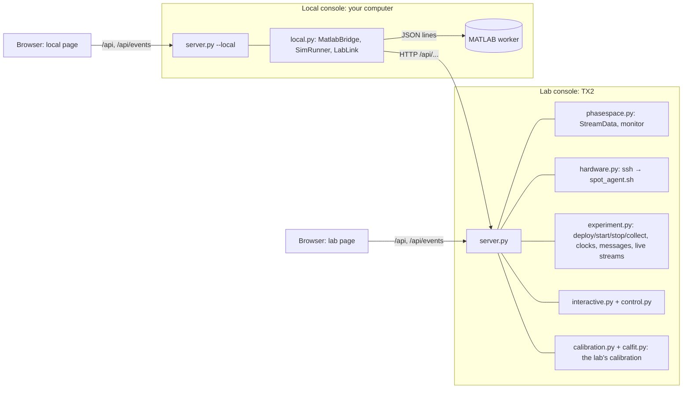

# The Console's Server (server.py and app.py)

**Files:** `+spot/+console/webapp/app.py`, `spot_console/server.py` (and the other modules of `spot_console/`)

<!-- source: +spot/+console/webapp/app.py -->
<!-- source: +spot/+console/webapp/spot_console/__init__.py -->
<!-- source: +spot/+console/webapp/spot_console/server.py -->

## What it is

One Python program (3.6+, standard library only) that is **two consoles** depending on how it is started:

| | Lab console | Local console |
|---|---|---|
| Started by | `deploy_tx2.sh`'s systemd service on the TX2: `app.py --host 0.0.0.0 --port 8080` | `SPOT` in MATLAB ([[spot.console.start|spot-console-start]]): `app.py --local --port 0 --worker-port 0 --root <project> --ready-file …` |
| Reachable from | the whole lab network | this computer only (`127.0.0.1`), with a session token |
| Tabs | PhaseSpace, Hardware, Designer, Calibration | Simulation, Experiment, Results, Designer, Calibration |
| Talks to | StreamData, the platforms (SSH), the PhaseSpace monitor | the MATLAB worker (a local socket), and the lab console (HTTP) |

The page (`static/`) is the same for both; it asks `/api/state` which features it has and shows the matching tabs.



The modules, each on its own page: [[common.py|Console-common]], [[events.py|Console-events]], [[phasespace.py|Console-phasespace]], [[hardware.py|Console-hardware]], [[control.py|Console-control]], [[interactive.py|Console-interactive]], [[experiment.py|Console-experiment]], [[local.py|Console-local]], [[files.py|Console-files]], [[design.py|Console-design]], [[calibration.py|Console-calibration]], [[calfit.py|Console-calfit]].

## `app.py`

Lines 29–37: put `webapp/` on the import path and call `spot_console.server.main()`. The docstring is the usage.

## `server.py`, function by function

**Lines 42–49.** `features`: what this server offers (mode `local` or `lab` and which tabs; `calibration` on both).

**Lines 52–81.** `app_state`: everything a page needs when it opens (`GET /api/state`): the features, the client's own IP, the host, the log history, and in lab mode the settings, toolchains, build, stream, monitor, LED owners, hardware, experiment, interactive status, the design, the calibration (`calibration`), the calibration running now (`calibration_run`) and what the console assumes of each platform (`calibration_assumed`, `calibration.assumed_defaults()`: its mass, inertia, thrust and centre of gravity [mm]); in local mode MATLAB's status, the simulation and build runners, the lab link, the design and the project's calibration.

**Lines 84–145.** `update_settings` (lab mode, `POST /api/settings`): validate each setting that was sent (output folder absolute; frequency 1–960; viewer port 1024–65535 and not SPOT's, not while streaming; extra destinations valid IPv4, not in StreamData's fixed list, at most 20; transport; platform addresses), save, and apply what can be applied live (tell a running StreamData to add/remove destinations, re-point the monitor, reconfigure a platform whose address changed), then publish `settings` and `stream_status`.

**Lines 148–495, `Handler`.** The HTTP request handler (one thread per request):
- `_local_host_ok` (154–158): in local mode, only answer requests whose `Host` is the loopback name (a DNS-rebinding defence); `_cookie_name` (160–161): the token cookie is per port.
- `do_GET` (163–230): `/` serves `index.html` (in local mode, a valid `?token=` in the URL is stored in an `HttpOnly; SameSite=Strict` cookie so the plain address works from then on); `/static/…` serves the page's files (never outside the folder); `/api/ping`, `/api/state`; `/api/sim/result` (the replay JSON, token required); `/api/tracker_positions`, `/api/stream` (a summary for scripts), `/api/design`, lab-only `/api/calibration/arm/check` (what the Chaser has for the arm calibration, from its agent's `arm-cal-check`), `/api/calibration` (the stored calibration, in lab mode the run under way as `run`, and `assumed`, each platform's mass, inertia, thrust and centre of gravity [mm] the console assumes, `calibration.assumed_defaults()`), `/api/hardware`; lab-only `/api/interactive`, `/api/experiment`, `/api/experiment/live`, `/api/experiment/build?model=`, `/api/experiment/download?run=` (a tar.gz); `/api/browse`; `/api/events` (the server-sent event stream).
- `do_POST` (232–368): requires `Content-Type: application/json` (so another web page can't trigger actions through the browser); values may also come in the URL (`?frequency=100` from scripts); the requester is the client's address, with "(webapp)" or the `X-SPOT-Requester` header. Local mode goes to `_local_post`. Lab mode: `/api/settings`, `/api/design`, `/api/calibration/table/start` (start a table slope calibration), `/api/calibration/thrusters/start` (start a thruster calibration), `/api/calibration/arm/start` (`{joints, tests, simulate, acknowledged}`: start the arm calibration on the Chaser, or a rehearsal with `simulate`; a real run needs `acknowledged`), `/api/calibration/stop`, `/api/calibration/clear` (`{section, platform}`: remove the `table`, `thrusters` (one platform's) or `arm` section, not while a calibration runs), `/api/build` (compile StreamData), `/api/stream/start|stop`, `/api/destinations/add|remove` (`ip=self` means the caller), `/api/tracker_positions`, `/api/toolchains/refresh`, `/api/mkdir`, `/api/experiment/deploy|start|stop|fetch`, `/api/interactive/start|goal|heartbeat|stop`, `/api/hardware/off` (one platform or all), `/api/hardware/pucks|thruster|check|check/cancel`. An `ApiError` becomes a 400 with the message (and details).
- `_authorized` (370–377): the token in the `X-SPOT-Token` header or the cookie.
- `_local_post` (379–448): local mode, token required: `/api/matlab` forwards a command from `MATLAB_COMMANDS` to the worker with its timeout (`workspace.eval` is echoed into the MATLAB log; `experiment.connect` needs the lab link up); `/api/sim/run` and `/api/experiment/build` start the background runners (the build only when the lab console is reachable and new enough); `/api/sim/stop` writes `.spot_cache/stop_request` (MATLAB's progress timer sees it, since Simulink doesn't read the socket while simulating); `/api/lab` forwards an allowed action to the lab console (`tracker_positions` sends this project's marker file); `/api/lab/address` re-points the lab link; `/api/design`; `/api/calibration/take` copies the lab console's calibration into the project (the Calibration tab's Update; the project's own `sync` choices are kept); `/api/calibration/sync` stores `{ask}` (Never Ask Again) or `{declined}` (Not Now, for that calibration); `/api/lab/download`; `/api/shutdown`.
- `_send`, `_json`, `_file` (450–468): responses with `Cache-Control: no-cache`; files by extension.
- `_events` (470–495): the event stream: subscribe to the hub, send `retry: 2000`, then forward queued events, batching what is already waiting, with a keep-alive comment every 15 s.

**Lines 498–508.** `open_browser` (through `cmd.exe` under WSL) and a threading HTTP server (Python 3.6 lacks the standard one).

**Lines 511–567.** `main` (lab mode): the arguments; refuse Windows; start the server (a clear message if the port is taken); open the lab design file and the calibration file (`~/.spot_calibration.json`); start the toolchain check, the monitor, the broadcast loop, the hardware probes and the three UDP listeners (clocks, debug messages, live streams); print the address (and a warning when serving the whole network); open a browser; on Ctrl+C stop a running calibration, Interactive Mode, the hardware links and StreamData.

**Lines 570–578.** `lab_url_from_settings`: the lab console's URL from the project's `labConsoleAddress`, else the lab's usual one.

**Lines 581–614.** `main_local`: set `LOCAL` (the project folder, a random 24-byte token from `os.urandom`, the ready file), open the project's design file and its calibration file (`resources/spot_calibration.json`), start the server on `127.0.0.1` (port 0 = any), listen for the worker, start the lab link, write the ready file, and on exit delete the ready file if it is still this process's.

## The code
<!-- listing -->
<details>
<summary><b>+spot/+console/webapp/app.py</b> (37 lines; click to show)</summary>

```python
   1  #!/usr/bin/env python3
   2  """SPOT Console: compile StreamData, start/stop PhaseSpace streaming, and watch the spacecraft
   3  and LEDs live in 3D (PhaseSpace tab); switch the pucks and thrusters on RED/BLACK/BLUE and run
   4  thruster checks (Hardware tab).
   5  
   6  Runs on Linux: on the lab console (the Jetson TX2, installed by deploy_tx2.sh as a service on
   7  http://<tx2>:8080) or, for testing, on any Linux computer or WSL. With --local it is the local
   8  console that SPOT starts from MATLAB (Simulation, Experiment and Results tabs).
   9  
  10      python3 webapp/app.py                  # opens http://localhost:8080 in your browser
  11      python3 webapp/app.py --port 9000      # use a different web port
  12      python3 webapp/app.py --host 0.0.0.0   # reachable from other computers (see the warning it prints)
  13      python3 webapp/app.py --no-browser     # don't open a browser tab
  14  
  15  Needs only the Python standard library (3.6 or newer), plus g++ and make to compile.
  16  
  17  The code is in the spot_console package next to this file, one module per area (see
  18  spot_console/__init__.py); this file only starts it.
  19  
  20  Viewer: StreamData is started as "StreamData <frequency> <monitor_port>", which makes it send a
  21  copy of every packet to 127.0.0.1:<monitor_port>; this app listens there and forwards the data
  22  to the browser.
  23  
  24  Hardware: this app logs into each platform over SSH with its own key (~/.ssh/id_ed25519_spot_console,
  25  set up by setup_hardware_link.sh), which can only run ~/.spot/teensy_link.sh there, and writes the
  26  Teensy's command packets through it.
  27  """
  28  
  29  import os
  30  import sys
  31  
  32  sys.path.insert(0, os.path.dirname(os.path.abspath(__file__)))
  33  
  34  from spot_console.server import main  # noqa: E402
  35  
  36  if __name__ == "__main__":
  37      main()
```

</details>

<details>
<summary><b>+spot/+console/webapp/spot_console/__init__.py</b> (15 lines; click to show)</summary>

```python
   1  """The SPOT Console's server, one module per area (start it with webapp/app.py):
   2  
   3      common       project paths, the API error, checking values from requests
   4      events       console settings, the event hub that feeds every open page, running commands
   5      phasespace   compiling and running StreamData, the packet monitor, marker calibration
   6      hardware     Teensy packets, SSH links to the platforms' agents, pucks/thrusters/checks
   7      control      the template diagram's default LQR and thruster mixer, ported from +spot/+control
   8      interactive  Interactive Mode: flying platforms to poses set on the PhaseSpace tab, with control
   9      experiment   deploying, starting, stopping and collecting experiments on the platforms
  10      local        the local console: the MATLAB worker bridge, simulation/build runs, the lab link
  11      files        the folder browser
  12      server       the HTTP API and start-up (lab console or local console)
  13  
  14  Python 3.6 standard library only (the lab console runs on the TX2's Python 3.6.9).
  15  """
```

</details>

<details>
<summary><b>+spot/+console/webapp/spot_console/server.py</b> (614 lines; click to show)</summary>

```python
   1  """The HTTP server: the page, the JSON API, server-sent events, and starting up (lab or local).
   2  
   3  Part of the SPOT Console (webapp/app.py starts it).
   4  """
   5  
   6  import argparse
   7  import ipaddress
   8  import json
   9  import os
  10  import platform
  11  import queue
  12  import re
  13  import shutil
  14  import socket
  15  import subprocess
  16  import sys
  17  import threading
  18  import webbrowser
  19  from http.server import BaseHTTPRequestHandler, HTTPServer
  20  from pathlib import Path
  21  from socketserver import ThreadingMixIn
  22  from urllib.parse import parse_qs, urlparse
  23  
  24  from .common import ApiError, PROJECT_DIR, STATIC_DIR, parse_bool, parse_number
  25  from .events import hub, settings
  26  from .phasespace import PLATFORM_DIR, RESERVED_PORTS, WSL_INFO, broadcast_loop, builder, monitor, parse_frequency, read_base_destinations, read_led_owner, save_tracker_positions, stream_summary, streamer, toolchains, tracker_positions_path
  27  from .hardware import NUM_THRUSTERS, hardware, parse_platforms
  28  from .experiment import experiment
  29  from .interactive import interactive
  30  from . import local   # local.lab: the link to the lab console, set when the local console starts
  31  from .local import LOCAL, LabLink, MATLAB_COMMANDS, build_runner, check_token, download_run, matlab, sim_runner, write_ready_file
  32  from .files import browse, make_folder
  33  from .design import design_store
  34  from .calibration import assumed_defaults, calibrator, store as calibration_store
  35  
  36  
  37  CONTENT_TYPES = {".html": "text/html; charset=utf-8", ".js": "text/javascript; charset=utf-8",
  38                   ".css": "text/css; charset=utf-8", ".svg": "image/svg+xml", ".png": "image/png",
  39                   ".txt": "text/plain; charset=utf-8", ".json": "application/json", ".gz": "application/gzip"}
  40  
  41  
  42  def features():
  43      """What this server offers: the lab console (TX2) runs PhaseSpace and the hardware; the local
  44      console (started by SPOT.m) runs simulations through the user's MATLAB."""
  45      if LOCAL["enabled"]:
  46          return {"mode": "local", "phasespace": False, "hardware": False, "simulation": True, "experiment": True,
  47                  "results": True, "designer": True, "calibration": True}
  48      return {"mode": "lab", "phasespace": True, "hardware": True, "simulation": False, "experiment": False,
  49              "results": False, "designer": True, "calibration": True}
  50  
  51  
  52  def app_state(client_ip=None):
  53      if LOCAL["enabled"]:
  54          return {"features": features(), "client_ip": client_ip, "project_dir": LOCAL["root"],
  55                  "host": {"os": platform.system(), "name": socket.gethostname(), "wsl": WSL_INFO},
  56                  "logs": hub.history(), "matlab": matlab.status(), "sim": sim_runner.status(), "build": build_runner.status(),
  57                  "lab_url": local.lab.url, "lab": local.lab.status(), "design": design_store.get(),
  58                  "calibration": calibration_store.get()}
  59      return {
  60          "features": features(),
  61          "client_ip": client_ip,  # the address this browser connects from ("Add this computer")
  62          "base_destinations": read_base_destinations(),
  63          "host": {"os": platform.system(), "name": socket.gethostname(), "wsl": WSL_INFO},
  64          "project_dir": str(PROJECT_DIR),
  65          "settings": settings.all(),
  66          "platform_dir": PLATFORM_DIR,
  67          "toolchains": toolchains.get(),
  68          "build": builder.status(),
  69          "stream": streamer.status(),
  70          "monitor": monitor.status(),
  71          "logs": hub.history(),
  72          "led_owner": read_led_owner(),
  73          "hardware": hardware.status(),
  74          "experiment": experiment.status(),
  75          "interactive": interactive.status(),
  76          "interactive_info": interactive.info(),
  77          "design": design_store.get(),
  78          "calibration": calibration_store.get(),
  79          "calibration_run": calibrator.status(),
  80          "calibration_assumed": assumed_defaults(),
  81      }
  82  
  83  
  84  def update_settings(body):
  85      changes = {}
  86      if "output_dir" in body:
  87          d = str(body["output_dir"]).strip()
  88          if not d:
  89              raise ApiError("Choose an output folder.")
  90          p = Path(d).expanduser()
  91          if not p.is_absolute():
  92              raise ApiError("The output folder must be a full path.")
  93          changes["output_dir"] = str(p)
  94      if "frequency" in body:
  95          changes["frequency"] = parse_frequency(body["frequency"])
  96      if "monitor_port" in body:
  97          try:
  98              port = int(body["monitor_port"])
  99          except (TypeError, ValueError):
 100              raise ApiError("Viewer port must be a number.")
 101          if not 1024 <= port <= 65535 or port in RESERVED_PORTS:
 102              raise ApiError("Viewer port must be 1024-65535 and not 31534/31535 (used by SPOT).")
 103          if port != settings.get("monitor_port") and streamer.status()["running"]:
 104              raise ApiError("Stop streaming before changing the viewer port.")
 105          changes["monitor_port"] = port
 106      if "extra_destinations" in body:
 107          value = body["extra_destinations"]
 108          if not isinstance(value, list):
 109              raise ApiError("extra_destinations must be a list of IP addresses.")
 110          base, extras = read_base_destinations(), []
 111          for item in value:
 112              try:
 113                  ip = str(ipaddress.IPv4Address(str(item).strip()))
 114              except ValueError:
 115                  raise ApiError("%r is not an IPv4 address (e.g. 192.168.1.43)." % item)
 116              if ip in base:
 117                  raise ApiError("%s is already in StreamData's fixed list." % ip)
 118              if ip not in extras:
 119                  extras.append(ip)
 120          if len(extras) > 20:
 121              raise ApiError("At most 20 extra destinations.")
 122          changes["extra_destinations"] = extras
 123      if "transport" in body:
 124          if body["transport"] not in ("tcp", "udp"):
 125              raise ApiError("Transport must be tcp or udp.")
 126          changes["transport"] = body["transport"]
 127      if "platforms" in body:
 128          changes["platforms"] = parse_platforms(body["platforms"])
 129      old_extras, old_platforms = settings.get("extra_destinations"), settings.get("platforms")
 130      data = settings.update(changes)
 131      if "extra_destinations" in changes:  # apply to a running stream right away
 132          for ip in old_extras:
 133              if ip not in changes["extra_destinations"]:
 134                  streamer.command("dest remove " + ip)
 135          for ip in changes["extra_destinations"]:
 136              if ip not in old_extras:
 137                  streamer.command("dest add " + ip)
 138      if "monitor_port" in changes:
 139          monitor.ensure(changes["monitor_port"])
 140      for name, cfg in changes.get("platforms", {}).items():
 141          if cfg != old_platforms.get(name):
 142              hardware.get(name).reconfigure()
 143      hub.publish("settings", data)
 144      hub.publish("stream_status", streamer.status())
 145      return data
 146  
 147  
 148  class Handler(BaseHTTPRequestHandler):
 149      server_version = "SPOTConsole/1.0"
 150  
 151      def log_message(self, fmt, *args):
 152          pass  # keep the terminal quiet
 153  
 154      def _local_host_ok(self):
 155          """Local console: only answer requests addressed to this computer by its loopback name. A
 156          web page whose own domain is pointed at 127.0.0.1 (DNS rebinding) is turned away."""
 157          host = (self.headers.get("Host") or "").rsplit(":", 1)[0].strip("[]").lower()
 158          return host in ("127.0.0.1", "localhost", "::1")
 159  
 160      def _cookie_name(self):
 161          return "spot_token_%d" % self.server.server_address[1]
 162  
 163      def do_GET(self):
 164          url = urlparse(self.path)
 165          qs = parse_qs(url.query)
 166          try:
 167              if LOCAL["enabled"] and not self._local_host_ok():
 168                  return self._send(403, b"Forbidden", "text/plain")
 169              if url.path == "/":
 170                  extra = None
 171                  if LOCAL["enabled"] and check_token(qs.get("token", [""])[0]):
 172                      # Remember the token in this browser, so the plain address works from now on
 173                      extra = [("Set-Cookie", "%s=%s; Path=/; HttpOnly; SameSite=Strict"
 174                                % (self._cookie_name(), LOCAL["token"]))]
 175                  return self._file(STATIC_DIR / "index.html", extra)
 176              if url.path.startswith("/static/"):
 177                  target = (STATIC_DIR / url.path[len("/static/"):]).resolve()
 178                  if STATIC_DIR not in target.parents:
 179                      return self._send(404, b"Not found", "text/plain")
 180                  return self._file(target)
 181              if url.path == "/api/ping":
 182                  return self._json({"ok": True, "mode": features()["mode"]})
 183              if url.path == "/api/state":
 184                  return self._json(app_state(self.client_address[0]))
 185              if url.path == "/api/sim/result":
 186                  if not self._authorized():
 187                      return self._json({"error": "Not allowed."}, 403)
 188                  path = sim_runner.result_path()
 189                  if path is None:
 190                      return self._json({"error": "No simulation result yet."}, 404)
 191                  return self._file(path)
 192              if url.path == "/api/tracker_positions":
 193                  path = tracker_positions_path()
 194                  return self._json({"path": str(path),
 195                                     "text": path.read_text(encoding="utf-8") if path.exists() else None})
 196              if url.path == "/api/stream":
 197                  return self._json(stream_summary())
 198              if url.path == "/api/design":
 199                  return self._json(design_store.get())
 200              if url.path == "/api/calibration/arm/check" and not LOCAL["enabled"]:
 201                  return self._json(calibrator.arm_check())
 202              if url.path == "/api/calibration":
 203                  return self._json(dict(calibration_store.get(), run=None if LOCAL["enabled"] else calibrator.status(),
 204                                         assumed=assumed_defaults()))
 205              if url.path == "/api/hardware":
 206                  return self._json(hardware.status())
 207              if url.path == "/api/interactive" and not LOCAL["enabled"]:
 208                  return self._json(dict(interactive.status(), controller=interactive.info()))
 209              if url.path == "/api/experiment" and not LOCAL["enabled"]:
 210                  return self._json(experiment.status())
 211              if url.path == "/api/experiment/live" and not LOCAL["enabled"]:
 212                  return self._json({"streams": experiment.live_data()})
 213              if url.path == "/api/experiment/build" and not LOCAL["enabled"]:
 214                  try:
 215                      return self._json({"build": experiment.build_info(qs.get("model", [""])[0])})
 216                  except ApiError as e:
 217                      return self._json({"error": str(e)}, 400)
 218              if url.path == "/api/experiment/download" and not LOCAL["enabled"]:
 219                  try:
 220                      data = experiment.archive(qs.get("run", [""])[0])
 221                  except ApiError as e:
 222                      return self._json({"error": str(e)}, 404)
 223                  return self._send(200, data, "application/gzip")
 224              if url.path == "/api/browse":
 225                  return self._json(browse(qs.get("path", [""])[0]))
 226              if url.path == "/api/events":
 227                  return self._events()
 228              self._send(404, b"Not found", "text/plain")
 229          except (BrokenPipeError, ConnectionResetError, ConnectionAbortedError):
 230              pass
 231  
 232      def do_POST(self):
 233          # Requiring the JSON content type stops other web pages from triggering actions through the
 234          # browser. Values may come in the JSON body or the URL (?frequency=100, easier from scripts).
 235          if not self.headers.get("Content-Type", "").startswith("application/json"):
 236              return self._json({"error": "Send the header \"Content-Type: application/json\"."}, 415)
 237          try:
 238              length = int(self.headers.get("Content-Length") or 0)
 239              body = json.loads(self.rfile.read(length) or b"{}") if length else {}
 240              if not isinstance(body, dict):
 241                  raise ValueError
 242              url = urlparse(self.path)
 243              for key, values in parse_qs(url.query).items():
 244                  body.setdefault(key, values[-1])
 245              path = url.path
 246              requester = self.client_address[0] + (" (webapp)" if self.headers.get("X-SPOT-Client") == "webapp" else "")
 247              via = re.sub(r"[^\w .,()@-]", "", self.headers.get("X-SPOT-Requester", ""))[:80]
 248              if via:
 249                  requester = "%s (%s)" % (self.client_address[0], via)
 250              if LOCAL["enabled"] and not self._local_host_ok():
 251                  return self._json({"error": "Forbidden"}, 403)
 252              if LOCAL["enabled"]:
 253                  return self._json(*self._local_post(path, body, requester))
 254              if path == "/api/settings":
 255                  result = update_settings(body)
 256              elif path == "/api/design":
 257                  result = design_store.set(body.get("design"), requester)
 258              elif path == "/api/calibration/table/start":
 259                  result = calibrator.start_table(body, requester)
 260              elif path == "/api/calibration/thrusters/start":
 261                  result = calibrator.start_thrusters(body, requester)
 262              elif path == "/api/calibration/arm/start":
 263                  result = calibrator.start_arm(body, requester)
 264              elif path == "/api/calibration/stop":
 265                  result = calibrator.stop(requester)
 266              elif path == "/api/calibration/clear":
 267                  # Remove a section (and a platform's, for thrusters) from the lab's calibration
 268                  section = str(body.get("section", ""))
 269                  if section not in ("table", "thrusters", "arm"):
 270                      raise ApiError("section must be table, thrusters or arm.")
 271                  if calibrator.active():
 272                      raise ApiError("A calibration is running; wait for it to finish.")
 273                  platform = str(body.get("platform") or "").upper() or None
 274                  if section == "thrusters" and platform not in ("RED", "BLACK", "BLUE"):
 275                      raise ApiError("Say which platform's thruster calibration to remove.")
 276                  hub.log("hardware", "Calibration: %s%s removed (by %s)" % (section, " " + platform if platform else "", requester))
 277                  result = calibration_store.set_section(section, None, platform)
 278              elif path == "/api/build":
 279                  builder.start()
 280                  result = builder.status()
 281              elif path == "/api/stream/start":
 282                  freq = parse_frequency(body.get("frequency", settings.get("frequency")))
 283                  streamer.start(freq, requester)
 284                  update_settings({"frequency": freq})  # remembered as the page's default
 285                  result = stream_summary()
 286              elif path == "/api/stream/stop":
 287                  streamer.stop(requester)
 288                  result = stream_summary()
 289              elif path in ("/api/destinations/add", "/api/destinations/remove"):
 290                  # ip=self means the computer sending this request (e.g. the SPOT GUI's own machine)
 291                  ip = str(body.get("ip", "")).strip()
 292                  if ip == "self":
 293                      ip = self.client_address[0]
 294                  extras = list(settings.get("extra_destinations"))
 295                  if ip in read_base_destinations():
 296                      # already always sent to (e.g. the ground station): nothing to add or remove
 297                      result = {"extra_destinations": extras, "ip": ip, "note": "%s is one of the fixed destinations" % ip}
 298                  else:
 299                      if path.endswith("add") and ip not in extras:
 300                          extras.append(ip)
 301                      elif path.endswith("remove"):
 302                          extras = [e for e in extras if e != ip]
 303                      result = {"extra_destinations": update_settings({"extra_destinations": extras})["extra_destinations"],
 304                                "ip": ip}
 305              elif path == "/api/tracker_positions":
 306                  result = save_tracker_positions(body.get("text"), requester)
 307              elif path == "/api/toolchains/refresh":
 308                  toolchains.refresh()
 309                  result = toolchains.get()
 310              elif path == "/api/mkdir":
 311                  result = make_folder(body)
 312              elif path == "/api/experiment/deploy":
 313                  result = experiment.deploy(str(body.get("model", "")), body.get("platforms"), requester)
 314              elif path == "/api/experiment/start":
 315                  result = experiment.start(body.get("platforms"), requester)
 316              elif path == "/api/experiment/stop":
 317                  result = experiment.stop(requester)
 318              elif path == "/api/experiment/fetch":
 319                  result = experiment.fetch(requester)
 320              elif path == "/api/interactive/start":
 321                  # Fly platforms (each to its goal, or holding where it is) with the diagram's controller:
 322                  # {"platforms": {"RED": {"x", "y", "att"} or null, ...}}, or one "platform" and its "goal"
 323                  goals = body.get("platforms")
 324                  if goals is None and body.get("platform"):
 325                      goals = {body.get("platform"): body.get("goal")}
 326                  result = interactive.start(goals, str(body.get("client") or ""), requester)
 327              elif path == "/api/interactive/goal":
 328                  result = interactive.set_goal(body.get("platform"), body, str(body.get("client") or ""),
 329                                                final=parse_bool(body.get("final", True), "final"))
 330              elif path == "/api/interactive/heartbeat":
 331                  result = interactive.heartbeat(str(body.get("client") or ""))
 332              elif path == "/api/interactive/stop":
 333                  # One "platform", or all of them
 334                  result = interactive.stop(requester, body.get("platform"))
 335              elif path == "/api/hardware/off":
 336                  # No platform (or "all"): every platform
 337                  if str(body.get("platform") or "all").lower() == "all":
 338                      hardware.all_off(requester)
 339                      result = hardware.status()
 340                  else:
 341                      p = hardware.get(body.get("platform"))
 342                      p.all_off(requester)
 343                      result = p.status()
 344              elif path.startswith("/api/hardware/"):
 345                  p = hardware.get(body.get("platform"))
 346                  if path == "/api/hardware/pucks":
 347                      p.set_pucks(parse_bool(body.get("on"), "on"), requester)
 348                  elif path == "/api/hardware/thruster":
 349                      thruster = parse_number(body.get("thruster"), "thruster", 1, NUM_THRUSTERS)
 350                      if thruster != int(thruster):
 351                          raise ApiError("thruster must be 1-%d." % NUM_THRUSTERS)
 352                      p.set_thruster(int(thruster) - 1, parse_number(body.get("duty", 100), "duty", 0, 100), requester)
 353                  elif path == "/api/hardware/check":
 354                      p.start_check(parse_number(body.get("duration", 0.5), "duration", 0.2, 10), requester)
 355                  elif path == "/api/hardware/check/cancel":
 356                      p.cancel_check(requester)
 357                  else:
 358                      return self._json({"error": "Not found"}, 404)
 359                  result = p.status()
 360              else:
 361                  return self._json({"error": "Not found"}, 404)
 362              self._json(result)
 363          except ApiError as e:
 364              self._json({"error": str(e), "details": e.details} if e.details else {"error": str(e)}, 400)
 365          except ValueError:
 366              self._json({"error": "Invalid request."}, 400)
 367          except (BrokenPipeError, ConnectionResetError, ConnectionAbortedError):
 368              pass
 369  
 370      def _authorized(self):
 371          if check_token(self.headers.get("X-SPOT-Token")):
 372              return True
 373          for part in (self.headers.get("Cookie") or "").split(";"):
 374              name, _, value = part.strip().partition("=")
 375              if name == self._cookie_name() and check_token(value):
 376                  return True
 377          return False
 378  
 379      def _local_post(self, path, body, requester):
 380          """POST requests of the local console. Returns (data, status)."""
 381          if not self._authorized():
 382              return {"error": "This page can't talk to MATLAB: open it with the link SPOT printed in MATLAB "
 383                               "(or run SPOT open there)."}, 403
 384          if path == "/api/matlab":
 385              cmd = str(body.get("cmd", ""))
 386              if cmd not in MATLAB_COMMANDS:
 387                  raise ApiError("Unknown MATLAB command %r." % cmd)
 388              args = body.get("args") or {}
 389              if not isinstance(args, dict):
 390                  raise ApiError("args must be an object.")
 391              if cmd == "workspace.eval":
 392                  hub.log("matlab", ">> %s" % str(args.get("command", ""))[:500])
 393              if cmd == "experiment.connect" and not local.lab.status()["reachable"]:
 394                  raise ApiError("The lab console isn't reachable: connect to the lab network first.")
 395              return {"result": matlab.request(cmd, args, timeout=MATLAB_COMMANDS[cmd])}, 200
 396          if path == "/api/sim/run":
 397              return sim_runner.start(requester), 200
 398          if path == "/api/experiment/build":
 399              if not local.lab.status()["reachable"]:
 400                  raise ApiError("The lab console isn't reachable: experiments can only be built on the lab network.")
 401              if not local.lab.status()["experiments"]:
 402                  raise ApiError("The lab console runs an older version without experiments: update it with deploy_tx2.sh.")
 403              return build_runner.start(requester), 200
 404          if path == "/api/sim/stop":
 405              # MATLAB doesn't read the connection while Simulink runs, but its progress timer
 406              # checks for this file (see Worker.m, sim.run)
 407              if not sim_runner.status()["running"]:
 408                  return {"stopping": False}, 200
 409              stop_file = Path(LOCAL["root"]) / ".spot_cache" / "stop_request"
 410              stop_file.write_text("stop")
 411              hub.log("matlab", "Stop requested (by %s)" % requester)
 412              return {"stopping": True}, 200
 413          if path == "/api/lab":
 414              # A lab action from the Experiment tab, forwarded to the lab console
 415              action = str(body.get("path", ""))
 416              if action.split("?", 1)[0] in LabLink.READS:
 417                  return {"result": local.lab.request("GET", action)}, 200
 418              if action.split("?", 1)[0] not in LabLink.ACTIONS:
 419                  raise ApiError("Not a lab action: %r" % action)
 420              payload = body.get("body") or {}
 421              if action == "tracker_positions":   # this project's marker calibration
 422                  f = Path(LOCAL["root"]) / "resources" / "tracker_positions_phasespace.txt"
 423                  if not f.is_file():
 424                      raise ApiError("This project has no resources/tracker_positions_phasespace.txt.")
 425                  payload = {"text": f.read_text(encoding="utf-8")}
 426              return {"result": local.lab.request("POST", action, payload)}, 200
 427          if path == "/api/lab/address":
 428              # The Experiment tab's lab console address (the settings' labConsoleAddress)
 429              return {"lab": local.lab.set_address(body.get("address", "")), "lab_url": local.lab.url}, 200
 430          if path == "/api/design":
 431              return design_store.set(body.get("design"), requester), 200
 432          if path == "/api/calibration/take":
 433              # The project's copy of the calibration becomes the lab console's (the page's Update)
 434              lab_cal = local.lab.request("GET", "calibration").get("calibration")
 435              if not lab_cal or not lab_cal.get("updated"):
 436                  raise ApiError("The lab console has no calibration yet.")
 437              hub.log("matlab", "Calibration updated from the lab console (%s)" % lab_cal.get("updated"))
 438              return calibration_store.take(lab_cal), 200
 439          if path == "/api/calibration/sync":
 440              # Whether to offer the lab's newer calibration: {"ask": false} (Never Ask Again), or
 441              # {"declined": "<the lab's updated>"} (Not Now: not again for that calibration)
 442              return calibration_store.set_sync(ask=body.get("ask"), declined=body.get("declined")), 200
 443          if path == "/api/lab/download":
 444              return download_run(str(body.get("run", ""))), 200
 445          if path == "/api/shutdown":
 446              threading.Thread(target=LOCAL["server"].shutdown, daemon=True).start()
 447              return {"ok": True}, 200
 448          return {"error": "Not available in the local console."}, 404
 449  
 450      def _send(self, code, body, ctype, extra_headers=None):
 451          self.send_response(code)
 452          for name, value in extra_headers or ():
 453              self.send_header(name, value)
 454          self.send_header("Content-Type", ctype)
 455          self.send_header("Content-Length", str(len(body)))
 456          self.send_header("Cache-Control", "no-cache")
 457          self.end_headers()
 458          self.wfile.write(body)
 459  
 460      def _json(self, data, code=200):
 461          self._send(code, json.dumps(data, allow_nan=False).encode("utf-8"), "application/json")
 462  
 463      def _file(self, path, extra_headers=None):
 464          try:
 465              body = path.read_bytes()
 466          except OSError:
 467              return self._send(404, b"Not found", "text/plain")
 468          self._send(200, body, CONTENT_TYPES.get(path.suffix, "application/octet-stream"), extra_headers)
 469  
 470      def _events(self):
 471          self.send_response(200)
 472          self.send_header("Content-Type", "text/event-stream")
 473          self.send_header("Cache-Control", "no-cache")
 474          self.end_headers()
 475          q = hub.subscribe()
 476          try:
 477              self.wfile.write(b"retry: 2000\n\n")
 478              self.wfile.flush()
 479              while True:
 480                  try:
 481                      chunks = [q.get(timeout=15)]
 482                  except queue.Empty:
 483                      chunks = [": keep-alive\n\n"]
 484                  else:
 485                      try:  # send whatever else is already waiting in the same write
 486                          while len(chunks) < 200:
 487                              chunks.append(q.get_nowait())
 488                      except queue.Empty:
 489                          pass
 490                  self.wfile.write("".join(chunks).encode("utf-8"))
 491                  self.wfile.flush()
 492          except (BrokenPipeError, ConnectionResetError, ConnectionAbortedError, OSError):
 493              pass
 494          finally:
 495              hub.unsubscribe(q)
 496  
 497  
 498  def open_browser(url):
 499      if WSL_INFO and shutil.which("cmd.exe"):  # open it in the Windows browser
 500          subprocess.Popen(["cmd.exe", "/c", "start", "", url], cwd="/mnt/c",
 501                           stdout=subprocess.DEVNULL, stderr=subprocess.DEVNULL)
 502      else:
 503          webbrowser.open(url)
 504  
 505  
 506  class ThreadingHTTPServer(ThreadingMixIn, HTTPServer):
 507      """Same as http.server.ThreadingHTTPServer, which only exists from Python 3.7."""
 508      daemon_threads = True
 509  
 510  
 511  def main():
 512      parser = argparse.ArgumentParser(description="SPOT Console")
 513      parser.add_argument("--host", default="127.0.0.1",
 514                          help="address to serve on (default 127.0.0.1 = this computer only; 0.0.0.0 = whole network)")
 515      parser.add_argument("--port", type=int, default=8080, help="web port (default 8080)")
 516      parser.add_argument("--no-browser", action="store_true", help="do not open a browser tab")
 517      parser.add_argument("--local", action="store_true",
 518                          help="local console for simulations, started by SPOT.m in MATLAB (this computer only)")
 519      parser.add_argument("--worker-port", type=int, default=0, help="local mode: port the MATLAB worker connects to (0 = any)")
 520      parser.add_argument("--root", help="local mode: the SPOT project folder")
 521      parser.add_argument("--ready-file", help="local mode: where to write the ports and token for MATLAB")
 522      parser.add_argument("--lab-url", default=os.environ.get("SPOT_LAB_URL"),
 523                          help="local mode: the lab console (default: the project's spot_settings.json "
 524                               "labConsoleAddress, port 8080; else $SPOT_LAB_URL or http://192.168.1.116:8080)")
 525      args = parser.parse_args()
 526  
 527      if args.local:
 528          return main_local(args)
 529      if platform.system() == "Windows":
 530          sys.exit("The lab console runs on Linux (the TX2, or WSL): python3 webapp/app.py. "
 531                   "On Windows, SPOT in MATLAB starts the local console (app.py --local).")
 532  
 533      try:
 534          server = ThreadingHTTPServer((args.host, args.port), Handler)
 535      except OSError as e:
 536          sys.exit("Could not start the web server on %s:%d (%s). Is it already running? "
 537                   "Try --port 8081." % (args.host, args.port, e))
 538      server.daemon_threads = True
 539      design_store.open(Path.home() / ".spot_design.json")
 540      calibration_store.open(Path.home() / ".spot_calibration.json")
 541  
 542      toolchains.refresh()
 543      monitor.ensure(settings.get("monitor_port"))
 544      threading.Thread(target=broadcast_loop, daemon=True).start()
 545      hardware.start()
 546      if not LOCAL["enabled"]:   # the platforms send their clocks and messages to the lab console
 547          experiment.listen_clocks()
 548          experiment.listen_debug()
 549          experiment.listen_live()
 550  
 551      url = "http://%s:%d" % ("localhost" if args.host in ("127.0.0.1", "0.0.0.0") else args.host, args.port)
 552      print("SPOT Console running at %s  (Ctrl+C to quit)" % url)
 553      if args.host not in ("127.0.0.1", "localhost"):
 554          print("WARNING: serving on %s, so anyone on the network can compile, start streaming, "
 555                "browse folders on this computer and switch the platforms' pucks and thrusters." % args.host)
 556      if not args.no_browser:
 557          threading.Timer(0.8, open_browser, args=(url,)).start()
 558      try:
 559          server.serve_forever()
 560      except KeyboardInterrupt:
 561          print("\nShutting down...")
 562      finally:
 563          calibrator.shutdown()
 564          interactive.shutdown()
 565          hardware.shutdown()
 566          streamer.stop("the webapp shutting down")
 567          server.server_close()
 568  
 569  
 570  def lab_url_from_settings(root):
 571      """The lab console's URL from the project's settings (labConsoleAddress), or the usual one."""
 572      try:
 573          address = json.loads((root / "spot_settings.json").read_text(encoding="utf-8")).get("labConsoleAddress")
 574          if address:
 575              return LabLink.url_for(address)
 576      except (OSError, ValueError, ApiError, AttributeError):
 577          pass
 578      return "http://192.168.1.116:8080"
 579  
 580  
 581  def main_local(args):
 582      """Local console: Simulation tab only, served to this computer, MATLAB worker on another port."""
 583      LOCAL.update(enabled=True, root=str(Path(args.root or os.getcwd()).resolve()),
 584                   token=os.environ.get("SPOT_TOKEN") or os.urandom(24).hex())
 585      LOCAL["ready_file"] = args.ready_file or str(Path(LOCAL["root"]) / ".spot_cache" / "console.json")
 586      design_store.open(Path(LOCAL["root"]) / "spot_design.json")
 587      calibration_store.open(Path(LOCAL["root"]) / "resources" / "spot_calibration.json", local=True)
 588      try:
 589          server = ThreadingHTTPServer(("127.0.0.1", args.port), Handler)
 590      except OSError as e:
 591          sys.exit("Could not start the web server on port %d (%s)." % (args.port, e))
 592      server.daemon_threads = True
 593      LOCAL["server"] = server
 594      matlab.listen(args.worker_port)
 595      local.lab = LabLink(args.lab_url or lab_url_from_settings(Path(LOCAL["root"])))
 596      local.lab.start()
 597      web_port = server.server_address[1]
 598      write_ready_file(web_port)
 599      print("SPOT Console (local) at http://127.0.0.1:%d, MATLAB worker port %d" % (web_port, matlab.port))
 600      sys.stdout.flush()
 601      if not args.no_browser:
 602          url = "http://127.0.0.1:%d/?token=%s#simulation" % (web_port, LOCAL["token"])
 603          threading.Timer(0.5, webbrowser.open, args=(url,)).start()
 604      try:
 605          server.serve_forever()
 606      except KeyboardInterrupt:
 607          pass
 608      finally:
 609          server.server_close()
 610          try:   # this console is gone: don't let SPOT.m find it
 611              if json.loads(Path(LOCAL["ready_file"]).read_text()).get("pid") == os.getpid():
 612                  Path(LOCAL["ready_file"]).unlink()
 613          except (OSError, ValueError):
 614              pass
```

</details>
<!-- /listing -->
