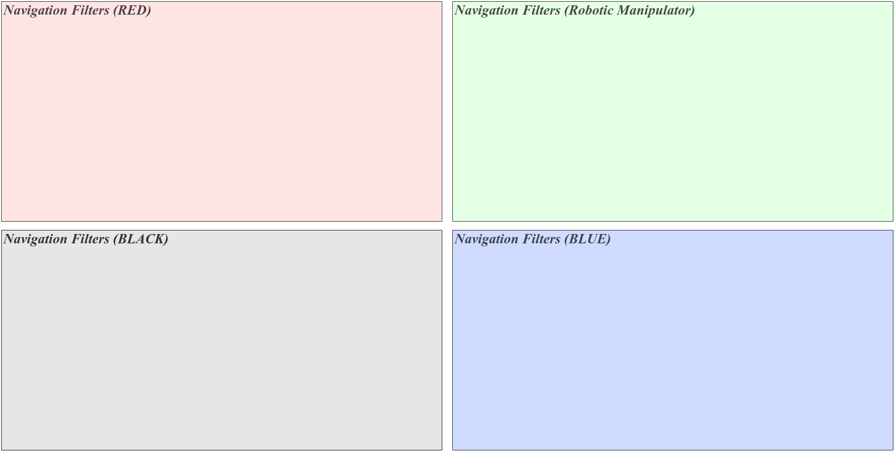

# 2 - Navigation

**Priority 40.** Empty.

This is the place for a **state estimator**: code that turns the raw measurements (`X_Measured_States` from the camera, `VIS_Measured_States` from the Orin, an IMU) into the states the controller should use. The template has none: the camera's measurements already are positions and velocities good enough to control with (see the EMA filter in [[PhaseSpace Camera Code|Diagram-PhaseSpace-Camera-Code]]), so [[4 - Control|Diagram-4-Control]] reads `X_Measured_States` directly.

If you add one, read the `X_Measured_States` store and write your estimate to a new data store (add a Data Store Memory block at the top level and a column to the [[Data Logger|Diagram-Data-Logger-Subsystem]] if you want it logged), then point the controller's **Data Store Read13** (and its siblings) at it. The subsystem's priority, 40, is already between the measurements (20–25) and the control (50).
