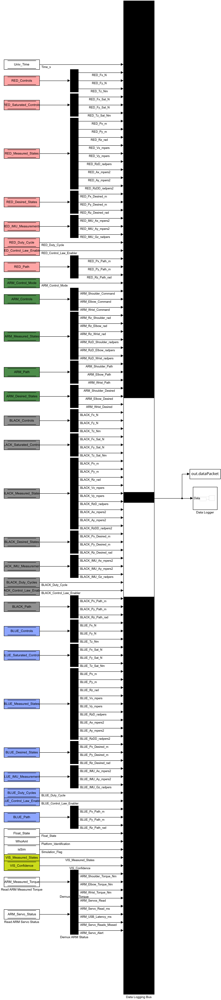
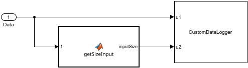

# Data Logger Subsystem

**Priority 80, the last thing in a step.** Everything worth keeping, gathered into one bus of **108 signals** and written to the record: `dataPacket` in the workspace during a simulation, the `ExpLog` files on the platform during an experiment. The signals and their units are listed on [[Logged Signals|Logged-Signals]].

**Reads:** 36 data stores: `Univ_Time`; for RED, BLACK and BLUE: `X_Controls`, `X_Saturated_Controls`, `X_Measured_States`, `X_Desired_States`, `X_IMU_Measurements`, `X_Duty_Cycle(s)`, `X_Control_Law_Enabler`, `X_Path`; for the arm: `ARM_Control_Mode`, `ARM_Controls`, `ARM_Measured_States`, `ARM_Path`, `ARM_Desired_States`, `ARM_Measured_Torque`, `ARM_Servo_Status`; and `Float_State`, `WhoAmI`, `isSim`, `VIS_Measured_States`, `VIS_Confidence`.

- 36 **Data Store Read** blocks and 23 **Demux** blocks split each vector store into scalar signals (`Demux2` splits `RED_Measured_States` into its nine states, `Demux ARM Status` the status 5-vector, …). Each scalar line is **named** on the diagram (`RED_Px_m`, `RED_Fx_N`, `ARM_Rz_Shoulder_rad`, …); that name becomes the signal's name in the record, and its suffix its unit ([[spot.plotting.signalLabel|spot-plotting-signalLabel]] reads `_m`, `_mpers`, `_rad`, `_N`, `_Nm`… for the plots' axis labels). Three stores stay as vectors: `X_Duty_Cycle` (8 columns), `VIS_Measured_States` (3).
- **Data Logging Bus** (a Bus Creator with 108 inputs) joins them, in the order of [[Logged Signals|Logged-Signals]].
- **To Workspace1** logs the bus as `dataPacket` (a structure of timeseries) in a simulation; [[spot.sim.run|spot-sim-run]] turns it into `dataClass`, one timeseries per signal, and the Results tab plots any of them.
- **Data Logger**:

  the MATLAB Function `getSizeInput` (`max(size(Input))`, the bus's width, so the logger is told how many values a row has) and the MATLAB System block [[spot.hardware.CustomDataLogger|spot-hardware-CustomDataLogger]]: on a platform it appends each step's 108 values as one line of text to the `ExpLog` file in the program's folder (`ExpLog`, `ExpLog1`, … so a second run on the platform doesn't overwrite the first; see [[custom_data_logger.cpp|Hardware-small-blocks]]); in a simulation it does nothing. After the experiment, **Collect** on the [[Experiment tab|Experiment-Tab]] fetches those files and [[spot.experiment.decodeData|spot-experiment-decodeData]] turns them into the same `dataClass` as a simulation gives, using the signal order of this bus.

**Adding a signal**: add a Data Store Read (or wire your signal in), name the line, add an input to the Bus Creator, and rebuild the tutorial's reference list (`python3 documentation/update_tutorial_reference.py`); `decodeData` reads the bus's names and widths from the compiled diagram, so experiment files pick up the new column too.
