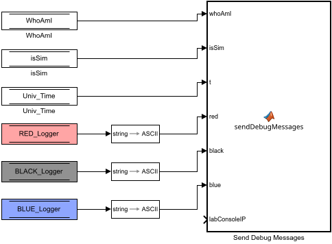
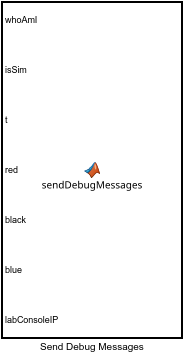

# Debugger

**Priority 72.** Each phase of [[1 - Experiment Logic|Diagram-1-Experiment-Logic]] writes a text into `RED_Logger`, `BLACK_Logger` and `BLUE_Logger` (its String Constants). This subsystem gets those texts to the console's **Messages** panel.

**Reads:** `RED_Logger`, `BLACK_Logger`, `BLUE_Logger`, `Univ_Time`, `WhoAmI`, `isSim`.

- Three **Data Store Reads** → **String to ASCII** blocks (`RED_Logger text` …): a Simulink string becomes a fixed-length `uint8` array, which the MATLAB Function block can take.
- **Send Debug Messages**:

  one line, `spot.hardware.debugMessages(whoAmI, isSim, t, red, black, blue, labConsoleIP)` ([[spot.hardware.debugMessages|spot-hardware-debugMessages]]):
  - **on a platform**: its own text goes to the lab console by UDP (RED 55001, BLACK 55002, BLUE 55003, as `[double t][text]`) when it changes and every 0.5 s otherwise, so the Experiment tab shows what each platform is doing and when it changed ([[experiment.py|Console-experiment]] keeps them and `Collect` saves them as `debug_messages.txt`);
  - **in a simulation**: every change of any of the three texts is recorded, time-stamped, for the console, which shows them in the Messages panel in step with the replay ([[spot.sim.debugLog|spot-sim-debugLog]], [[messages.js|Page-messages-js]]).

The texts are free: change the String Constants in the phases to say what your experiment is doing ("Approach: 1.2 m to go"), or write to `X_Logger` from anywhere in the diagram with a Data Store Write.
