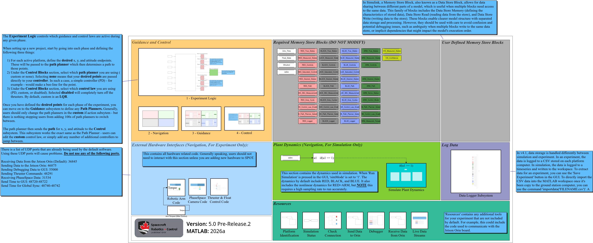
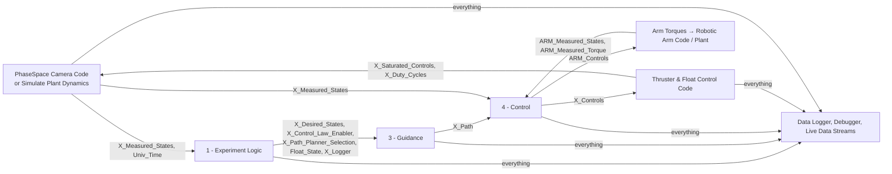

# The Simulink Diagram: Overview and Step Order

**File:** `Template_v5_0_0_2026a_Jetson_PSClock.slx` (renamed to `<YourProject>.slx` by [[New_SPOT_Project|Tool-New-SPOT-Project]]) · **Solver:** `ode4`, fixed step `baseRate`, stop time `tsim` ([[Workspace Variables|Workspace-Variables]])

## One diagram, two jobs

The same diagram is **simulated** on your computer and **compiled** for the three platforms' Jetson computers. Which it is doing is decided by one workspace variable, `simMode` (1 = simulation, 0 = experiment), written into the `isSim` data store by [[Simulation Status|Diagram-Status-and-Identification]] at the start of every step. Every subsystem that touches hardware, or that stands in for hardware, reads `isSim` (and `WhoAmI`, the platform this copy runs on) and runs or stays idle accordingly:

| In a simulation (`isSim` = 1) | On a platform (`isSim` = 0) |
|---|---|
| the clock is Simulink's | the clock comes from the PhaseSpace stream ([[spot.hardware.experimentTime|spot-hardware-experimentTime]]) |
| [[Simulate Plant Dynamics|Diagram-Simulate-Plant-Dynamics]] integrates the platforms' motion and writes the measured states | [[PhaseSpace Camera Code|Diagram-PhaseSpace-Camera-Code]] writes the measured states from the camera packets |
| the arm is [[spot.arm.Plant|spot-arm-Plant]] | the arm is the real servos ([[Robotic Arm Code|Diagram-Robotic-Arm-Code]]) |
| all three platforms' control code runs | only this platform's branch runs (`WhoAmI` 1 = RED, 2 = BLACK, 3 = BLUE) |
| the thruster serial write and the UDP sends do nothing | duty cycles go to the Teensy; clocks, messages and streams go to the lab console |

So "the GNC code" ([[1 - Experiment Logic|Diagram-1-Experiment-Logic]], [[2 - Navigation|Diagram-2-Navigation]], [[3 - Guidance|Diagram-3-Guidance]], [[4 - Control|Diagram-4-Control]], [[Thruster & Float Control Code|Diagram-Thruster-and-Float-Control-Code]]) is written once and is identical in both cases. What you write for your experiment goes into those four numbered subsystems.

## How the subsystems talk: data stores

The top-level subsystems have **no wires between them** (one exception: the arm's torque, below). They share **data stores**: named global variables (`RED_Measured_States`, `RED_Controls`, `Float_State`, …) that any block can read or write. The 49 of them are listed with their shapes and meanings on [[Data Stores|Data-Stores]]. Reading the diagram is therefore a matter of knowing, for each subsystem, *which stores it reads and which it writes*; each diagram page says so.

(`X` stands for RED, BLACK, BLUE and, where it applies, ARM.)

## The order within a step

Because the subsystems only communicate through data stores, the order in which they run within a step matters: a store must be written before it is read, or the reader sees last step's value. Every top-level subsystem is **atomic** (it runs as one unit) and has a **priority**; Simulink runs lower numbers first:

| Priority | Subsystem | Writes (for the ones that follow) |
|---|---|---|
| 5 | [[Simulation Status|Diagram-Status-and-Identification]] | `isSim` |
| 10 | [[Platform Identification|Diagram-Status-and-Identification]] | `WhoAmI` (experiments only) |
| 20 | [[PhaseSpace Camera Code|Diagram-PhaseSpace-Camera-Code]] | `Univ_Time`; on a platform also `RED/BLACK/BLUE_Measured_States` |
| 21 | [[Robotic Arm Code|Diagram-Robotic-Arm-Code]] | `ARM_Measured_States`, `ARM_Measured_Torque`, `ARM_Servo_Status` (RED, experiments only) |
| 22 | [[Receive Data from Orin|Diagram-Receive-Data-from-Orin]] | `VIS_Measured_States`, `VIS_Confidence` (experiments only) |
| 24, 25 | the `isSim` read and the If that runs… | |
| (inside the If) | [[Simulate Plant Dynamics|Diagram-Simulate-Plant-Dynamics]] | `X_True_States`, `X_Measured_States`, `ARM_*` (simulations only) |
| 30 | [[1 - Experiment Logic|Diagram-1-Experiment-Logic]] | `X_Desired_States`, `X_Control_Law_Enabler`, `X_Path_Planner_Selection`, `Float_State`, `X_Logger` |
| 40 | [[2 - Navigation|Diagram-2-Navigation]] | (empty: yours to fill) |
| 40 | [[3 - Guidance|Diagram-3-Guidance]] | `X_Path` |
| 50 | [[4 - Control|Diagram-4-Control]] | `X_Controls`, `ARM_Control_Mode` |
| 60 | [[Thruster & Float Control Code|Diagram-Thruster-and-Float-Control-Code]] | `X_Saturated_Controls`, `X_Duty_Cycles`; the Teensy packet |
| 61 | [[Arm Torques (After Control)|Diagram-Arm-Torques-After-Control]] | the torque wire into Robotic Arm Code |
| 70 | [[Send Data to Orin|Diagram-Outgoing-Links]] | UDP to the vision computer |
| 71 | [[Check Connection|Diagram-Outgoing-Links]] | the heartbeat UDP |
| 72 | [[Debugger|Diagram-Debugger]] | the `X_Logger` texts to the console |
| 73 | [[Live Data Streams|Diagram-Live-Data-Streams]] | the live-plot UDP / events |
| 80 | [[Data Logger Subsystem|Diagram-Data-Logger-Subsystem]] | the 108-signal record |

The plant simulation runs where its If block does (between the hardware inputs and the experiment logic), so a simulated measurement is one step old when the controller sees it, as a camera measurement is. It also reads `Float_State` (the table's slope pulls a platform only while it floats) before 1 - Experiment Logic writes it, so it uses last step's value; that store's read-before-write and write-after-read checks are off for this reason ([[Data Stores|Data-Stores]]). `documentation/demo_execution_order.m` ([[Tool-demo-execution-order]]) shows on a two-block diagram what goes wrong without atomic subsystems and priorities.

The one wire at the top level: **Arm Torques (After Control)** outputs the `ARM_Controls` torque *after* 4 - Control has written it (priority 61) and feeds it into **Robotic Arm Code** (priority 21). Robotic Arm Code therefore uses the torque computed in the previous step, like the real servo bus would: the command computed at step k reaches the servo at k+1. In simulation the plant reads `ARM_Controls` directly, one step after it was written, so both agree ("Match the simulation").

## Rates and sizes

- `baseRate` = 1 / Sample Rate (the Scenario pane's **Sample Rate**, 20 Hz → 0.05 s by default). Everything in the diagram runs at this rate (except the arm plant's own 1 ms sub-steps).
- `dataRate` = 1 / Data Rate: the period of the PhaseSpace packets (the camera stream's rate; the Experiment tab starts the stream at it). The simulation holds its measurements at this period ([[Diagram-Simulate-Plant-Dynamics]]) so the controller sees data like the camera's. In the GUI it is locked to the Sample Rate unless you unlock it.
- `PWMFreq`: the thrusters' PWM frequency (5 Hz): the duty cycles are held for a PWM period and valve opening times shorter than 7 ms are dropped ([[Diagram-Thruster-and-Float-Control-Code]]).
- Platform states are 9-vectors `[x y θ ẋ ẏ θ̇ ẍ ÿ θ̈]` in metres, radians and seconds in the table frame; controls are `[Fx Fy Tz]` in the table frame (N, N, N·m); duty cycles are 8-vectors in 0–1 (0–100 % when sent); the arm's states are `[θ1 θ2 θ3 θ̇1 θ̇2 θ̇3]` and its controls three torques (N·m).

## The pictures

Each diagram page shows the subsystem as exported from Simulink (`documentation/wiki/images/sub_*.png`). Block names in the pages are the ones in the diagram, so you can find them with Simulink's search. The MATLAB Function blocks that call `spot.hardware.*` are one-liners; their pages are in the [[spot.hardware|spot-hardware]] package.
