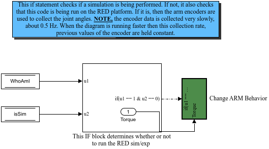
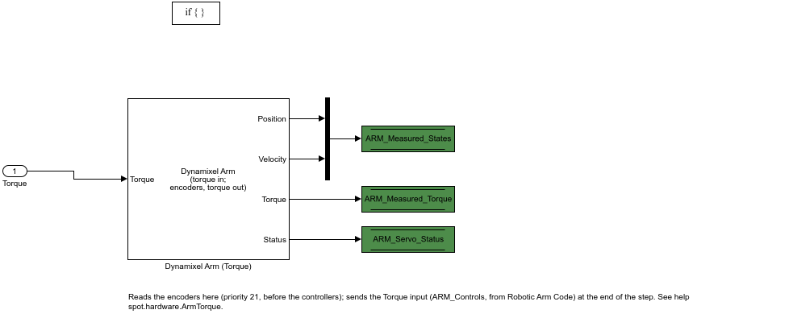

# Robotic Arm Code

**Priority 21.** On RED, during an experiment: send the joint torques to the three Dynamixel servos and read back what they measure. In a simulation this subsystem does nothing; [[spot.arm.Plant|spot-arm-Plant]] inside [[Simulate Plant Dynamics|Diagram-Simulate-Plant-Dynamics]] plays the servos.

**Input:** *Torque* (3 N·m), wired from [[Arm Torques (After Control)|Diagram-Arm-Torques-After-Control]], i.e. the `ARM_Controls` written by [[4 - Control|Diagram-4-Control]] in the **previous** step. **Writes:** `ARM_Measured_States`, `ARM_Measured_Torque`, `ARM_Servo_Status`. **Reads:** `WhoAmI`, `isSim`.

- **Data Store Read1** (`WhoAmI`), **Data Store Read2** (`isSim`) → **If** `u1 == 1 & u2 == 0`: RED, and an experiment.
- **Change ARM Behavior** (the action):

- **Dynamixel Arm (Torque)**: the MATLAB System block [[spot.hardware.ArmTorque|spot-hardware-ArmTorque]]. Each step it converts the three torques to goal currents (torque / torque constant, in the servos' 3.36 mA units, within the Current Limit; see [[Dynamixel Units|Math-Dynamixel-Units]]), writes them to the servos over the USB bus (a group sync write), and reads back the present positions, velocities and currents (a group sync read). Its four outputs:
  1. the joint angles (rad, 2π/4096 per encoder count),
  2. the joint rates (rad/s, 0.229 rpm per unit),
  3. the measured torques (N·m, from the present currents),
  4. the status 5-vector: servos read this step, the read's duration (ms), the USB latency timer (ms), reads missed, and an alert flag.
- **Mux** joins angles and rates into the 6-vector → **Data Store Write** `ARM_Measured_States`; the torques → `ARM_Measured_Torque`; the status → `ARM_Servo_Status`. All three are logged ([[Logged Signals|Logged-Signals]]).

Why the block replaced the old Position/Velocity Dynamixel blocks, and how the read rate went from about 2 Hz to the bus's limit, is told on [[spot.hardware.ArmTorque|spot-hardware-ArmTorque]] and [[arm_torque.cpp|Hardware-arm-torque]]: the servos run in **current control** for the whole experiment, and position or velocity control are controllers in [[4 - Control|Diagram-4-Control]] that output torques.
