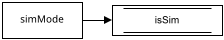
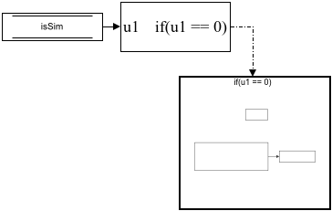

# Simulation Status and Platform Identification

The first two subsystems of every step (priorities 5 and 10). They answer two questions for the rest of the diagram: *is this a simulation?* and *which platform am I?*

## Simulation Status

Two blocks: a **Constant** `simMode` and a **Data Store Write** to `isSim`. `simMode` is a base-workspace variable: [[spot.sim.run|spot-sim-run]] sets it to 1 before a simulation and [[spot.experiment.build|spot-experiment-build]] to 0 before building for the platforms, so the compiled programs carry a 0. Every other subsystem reads `isSim` rather than `simMode`, so there is exactly one place where the decision is made.

## Platform Identification

- **Data Store Read1** reads `isSim`.
- **If** `u1 == 0`: only during an experiment.
- **Subsystem** (the If's action): the **WhoAmI** MATLAB System block ([[spot.hardware.IdentifyPlatform|spot-hardware-IdentifyPlatform]]) reads this computer's hostname once (`spot-red` → 1, `spot-black` → 2, `spot-blue` → 3) and the **Data Store Write** puts it in `WhoAmI`.

In a simulation the If does not fire, `WhoAmI` keeps its initial value 0, and every platform's branch in the later subsystems runs (their conditions are of the form `WhoAmI == n | isSim == 1`). On a platform exactly one branch runs. The number is also logged as `Platform_Identification` ([[Logged Signals|Logged-Signals]]), so an experiment's data file says which platform wrote it.
