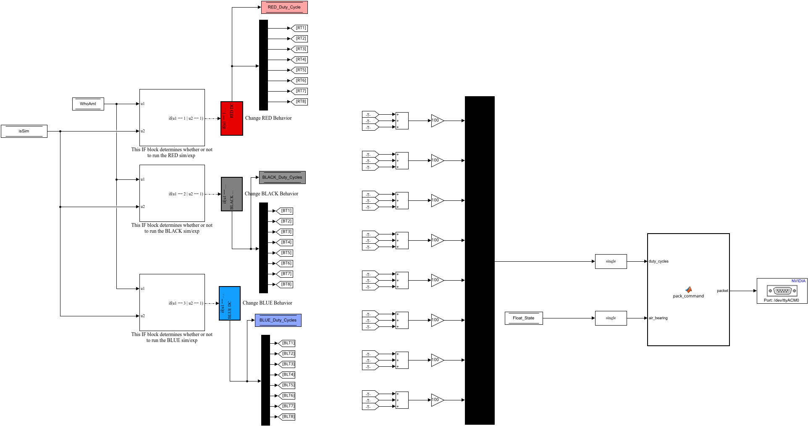
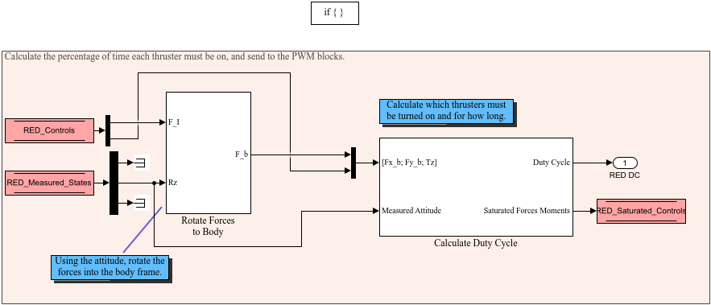
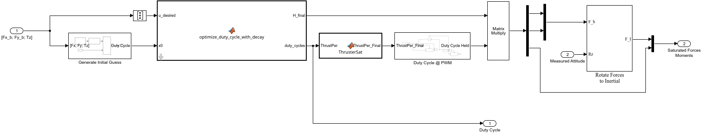

# Thruster & Float Control Code

**Priority 60.** From the force and torque the controller asked for, to the eight thruster duty cycles, and from those and the float state to the 37-byte packet the Teensy wants. Also where the force is **saturated** to what the thrusters can give, which is what the simulated plant then feels.

**Reads:** `WhoAmI`, `isSim`, `Float_State`, `X_Controls`, `X_Measured_States`. **Writes:** `X_Saturated_Controls`, `RED_Duty_Cycle`, `BLACK_Duty_Cycles`, `BLUE_Duty_Cycles`; the serial packet to the Teensy. The maths is on [[The Thruster Mixer|Math-Thruster-Mixer]].

## The top level

- Three **If** blocks, `WhoAmI == n | isSim == 1`: on a platform only its own **Change X Behavior** runs; in a simulation all three do.
- Each **Change X Behavior** outputs its platform's eight duty cycles (0–1), written to `X_Duty_Cycles` and split by a **Demux** into **Goto** tags `RT1…RT8`, `BT1…BT8`, `BLT1…BLT8`.
- Eight **Sum** blocks add `RTi + BTi + BLTi` (**From** tags): on a platform only one of the three is non-zero, so this is just "the duty cycles of whichever branch ran" without a Merge. **Gain** × 100 → percent; **Mux** → **Data Type Conversion1** (to `single`).
- **MATLAB Function2** `pack_command(duty_cycles, air_bearing)`: the same packet as [[spot.hardware.packCommand|spot-hardware-packCommand]]: byte 1 = `0xAA` (the sync byte), bytes 2–33 = the eight duty cycles as little-endian `single`, bytes 34–37 = the float state (`Float_State` through **Data Type Conversion2**) as a `single`: 37 bytes.
- **Serial Write1**: the Jetson support package's `SCIWrite` System object: the packet to the Teensy's USB serial port, every step. The Teensy ([[teensy_pwm_control.ino|Hardware-Teensy-Firmware]]) drives the eight valves with those duty cycles at its own fixed 5 Hz PWM (the console's **Thruster PWM** setting, `PWMFreq`, must say the same) and the puck solenoid, and switches everything off if no packet arrives for 2 s. In a simulation the block does nothing.

## Change BLACK Behavior (RED and BLUE are the same)

- **BLACK Controls** reads `BLACK_Controls` → **Demux1** `[2, 1]`: the force `[Fx Fy]` (table frame) and the torque `Tz`.
- **BLACK States** reads `BLACK_Measured_States` → **Demux2** `[2, 1, 6]`: only θ, the measured attitude, is used.
- **Rotate Forces to Body**: `RotateFrame(Rz)` builds

$$C_{bI} = \begin{bmatrix} \cos\theta & \sin\theta \\ -\sin\theta & \cos\theta \end{bmatrix}, \qquad \mathbf F_b = C_{bI}\,\mathbf F_I$$

  (a Product block): the force the controller wants, expressed along the platform's own axes, where the thrusters are.
- **Mux** `[Fx_b Fy_b Tz]` → **Calculate Duty Cycle**, which gives the duty cycles (→ *BLACK DC*) and the force and torque actually achievable (→ **Data Store Write2** `BLACK_Saturated_Controls`).

### Calculate Duty Cycle

The problem: find eight duty cycles $d_i \in [0, 1]$ such that the thrusters produce the wanted $[F_{x,b}\ F_{y,b}\ T_z]$. With the thruster geometry $H$ (3 × 8), the forces are $H\,d$:

1. **Generate Initial Guess**: `MakeH(thruster_dist2CG_BLACK, F_thrusters_BLACK)` builds $H$ from each thruster's direction (`Vec1`: thrusters 1, 2 push −x, 5, 6 push +x; `Vec2`: 3, 4 push +y, 7, 8 push −y), its lever arm about the CG (`Vec3`, the workspace's `thruster_dist2CG_*` in mm, from [[spot.massprops.compute|spot-massprops-compute]]) and its thrust (`F_thrusters_*`, 8×1 [N]: each thruster's own, the project's thruster calibration when it is used, else the nominal thrust for all eight; [[Workspace Variables|Workspace-Variables]]), halved: a thruster at 100 % is assumed to give half its thrust on average, see the decay below. **Pseudoinverse1** ($H^+$, a `dsp.simulink.Pseudoinverse` block) × the wanted vector (**Product3**) = the least-squares duty cycles, unconstrained: the starting point.
2. **MATLAB Function5** `optimize_duty_cycle_with_decay(u_desired, x0, thruster_dist2CG, F_thrusters, max_iters, tol)`: the constrained solve, with the same eight thrusts as `MakeH` (`F_thrusters_*`; the `F_*_X_nominal` / `F_*_Y_nominal` it used to read are no longer used). Repeat: build $H$ with the current **thrust decay factor** (`MakeHWithDecay`: each thruster's thrust times the factor); solve $\min_d \|Hd - u\|^2$ subject to $0 \le d \le 1$ by **projected gradient descent** (`custom_constrained_least_squares`: gradient $2H^\top(Hd - u)$, a backtracking line search, projection onto $[0, 1]$, up to 100 iterations); update the decay factor from the new duty cycles (`check_thrust_decay`: with $\bar d$ the mean duty of the active thrusters, the factor is 1 when $\bar d < 0.3$ and $\max(1.6 - 2\bar d,\ 0.5)$ above: the more the valves are open, the lower the tank pressure sags and the less each thruster gives); stop when the duty cycles change by less than `tol`. Outputs: the duty cycles and `H_final`, the geometry with the final decay and the **full** thrust of each thruster (`MakeHWithDecayRecalculateForce`). With all eight thrusts equal (no thruster calibration) the duty cycles are exactly those of the earlier x/y version.
3. **MATLAB Function1** `ThrusterSat(ThrustPer, PWMFreq)`: if any duty cycle is above 1, scale them all down by the largest (the direction of the force is kept, its size is not); then any duty cycle whose opening time $d_i / \text{PWMFreq}$ is shorter than the valve's 7 ms opening time becomes 0 (the valve would not open anyway).
4. **Duty Cycle @ PWM**: a sample-and-hold at `1/PWMFreq`, built like the camera's in [[Simulate Plant Dynamics|Diagram-Simulate-Plant-Dynamics]]: a new set of duty cycles is only let through once per PWM period, as the Teensy only applies a new duty at the start of a period. The output *Duty Cycle Held* is what is sent.
5. **Product1** `H_final × duty cycles` = the force and torque these duty cycles really give, in the body frame → **Demux**; **Rotate Forces to Inertial** (`C_{Ib} = C_{bI}^{-1}`) turns the force back into the table frame; **Mux1** `[Fx Fy Tz]` → *Saturated Forces Moments*.

The saturated controls are what the plant integrates in a simulation (so a saturated controller behaves in the simulation as it will on the table) and are logged as `X_Fx_Sat_N`, `X_Fy_Sat_N`, `X_Tz_Sat_Nm` next to the asked-for `X_Fx_N`… The duty cycles are logged as `X_Duty_Cycle` (8 columns).
