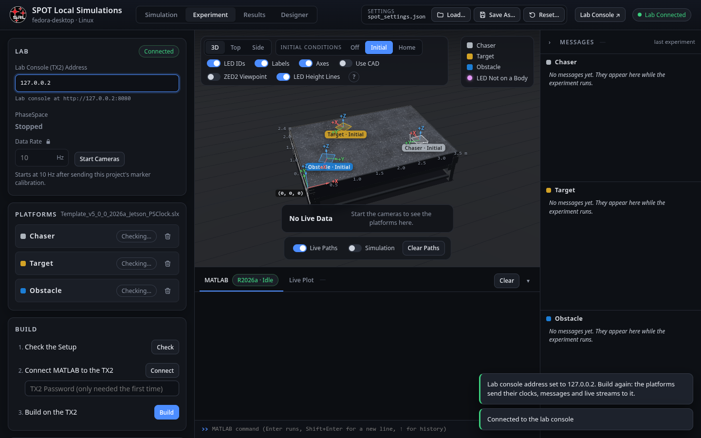
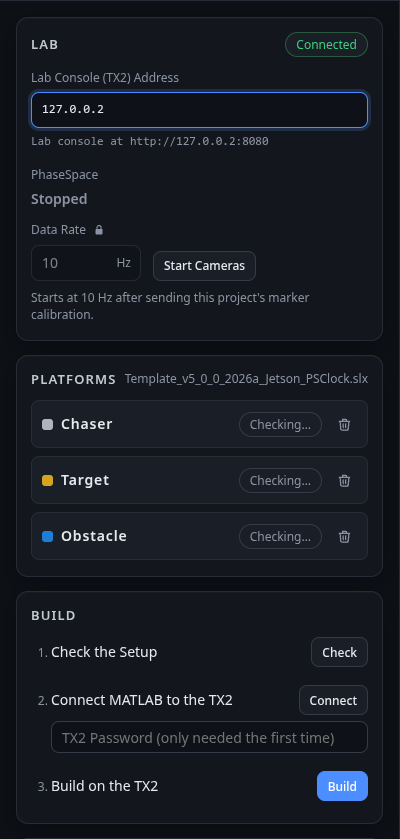
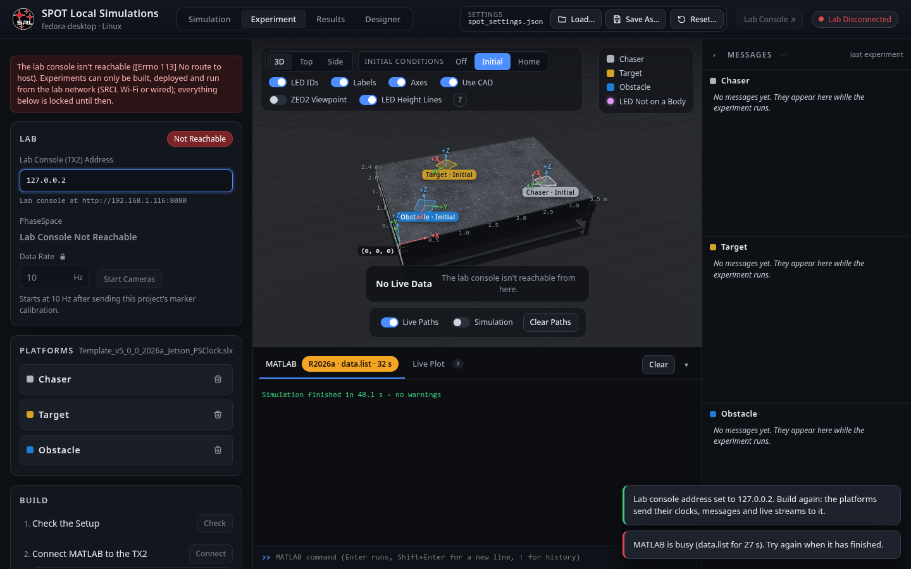

# The Experiment Tab

Running the diagram **on the platforms**, from your MATLAB, through the lab console. The tab is a checklist from top to bottom: Lab, PhaseSpace, Platforms, Build, Deploy & Run, Data. Everything that touches hardware is done by the lab console (the Jetson TX2); this page only asks it to. The code is [[experiment.js|Page-experiment-js]] in the page, [[spot.experiment|spot-experiment]] in MATLAB and [[experiment.py|Console-experiment]] on the lab console.

## Lab

- **Lab Console (TX2) Address**: where the lab console is (`192.168.1.116` by default). It is a setting (`labConsoleAddress`): the diagram compiles it in as `labConsoleIP`, the address every platform sends its clock, messages and streams to, so **after changing it, build again**. The pill says **Connected**, **Needs Update** (the lab console runs an older console than yours; update it with the deploy script) or **Not Reachable** with the reason; the local server keeps retrying every 3 s.

## PhaseSpace

- **Start Cameras** / **Stop Cameras**: starts [[StreamData|Hardware-StreamData]] on the lab console at the **Data Rate**, after sending it this project's marker calibration (`tracker_positions`, from the Platforms pane's mass properties). The line shows whether it is streaming and the packet rate the lab console sees.
- **Data Rate**: the same value as the Simulation tab's (they are one setting); locked unless you unlock it there.

## Platforms

A card per platform in the scenario (untick a platform in the Scenario, or the card's trash button, to leave it out): its hardware state as the lab console sees it (**Ready**, **No Teensy**, **In Use**, **Offline**, **No Access**), and once the experiment runs, its clock, its program's state and pid, how many data files it has written, and the tail of its log.

## Build

1. **Check** ([[spot.experiment.plan|spot-experiment-plan]]): what a build would do, without building: the platforms and their programs, the phases that will run, the changes since the last build, and warnings (a platform not selected, the arm without the Chaser, …).
2. **Connect** ([[spot.experiment.connect|spot-experiment-connect]]): MATLAB's connection to the TX2 for remote building, with the TX2's password (asked once; the connection is remembered).
3. **Build** ([[spot.experiment.build|spot-experiment-build]]): generates C code from the diagram for each selected platform (with `simMode = 0`), compiles it on the TX2 and leaves the `.elf` in `~/ExperimentSoftware/MATLAB_ws`. The log streams into the card as it goes; a build takes several minutes. **Details** on a failure opens the error in the command window.

The card also says whether a program for this diagram already exists on the TX2 and when it was built.

## Deploy & Run

- **Deploy**: the lab console copies the program (and the shared libraries it needs) to each platform over SSH.
- **Start Experiment**: the lab console checks that the cameras stream and every Teensy is free, starts each program, and waits until all of them report their clock; then it arms the clock in the PhaseSpace stream and **three seconds later all platforms leave phase 0 together**. The status line tells the story (waiting for which platforms, counting down, running since). Use the lab's **E-stop** if anything looks wrong; the Teensies also shut their valves after 2 s without a packet.
- **Stop**: stops every program and sends the Teensies an all-off.

While it runs: the 3D view shows the platforms live (the **Simulation** overlay replays the last simulation in step with the experiment's clock, so you can see how reality departs from the model), the Messages panel shows each platform's message, the Live Plot each platform's streams, and **Clear Paths** wipes the trails.

## Data

**Collect** (enabled once stopped): the lab console fetches each platform's `ExpLog` files and debug messages, your console downloads them into `Saved Data/<diagram>_<stamp>/<PLATFORM>/`, and MATLAB decodes them into `.mat` ([[spot.experiment.decodeData|spot-experiment-decodeData]]). The run then appears in the [[Results tab|Results-Tab]]'s **Saved Data…** list next to your simulations, with the same signal names ([[Logged Signals|Logged-Signals]]).

## A typical session

1. Simulate the experiment first; check the trajectory and the thruster duty cycles.
2. In the lab: platforms on the table, air on, pucks off, Teensies connected; the lab console's page shows them **Ready** on its [[Hardware tab|Lab-Console-Hardware-Tab]].
3. **Start Cameras**; check on the lab console's [[PhaseSpace tab|Lab-Console-PhaseSpace-Tab]] that every platform is tracked.
4. **Check → Connect → Build** (once per change of the diagram or settings).
5. **Deploy → Start Experiment**. Watch. **Stop** when phase 6 is reached (or earlier).
6. **Collect**, then compare in the Results tab.
