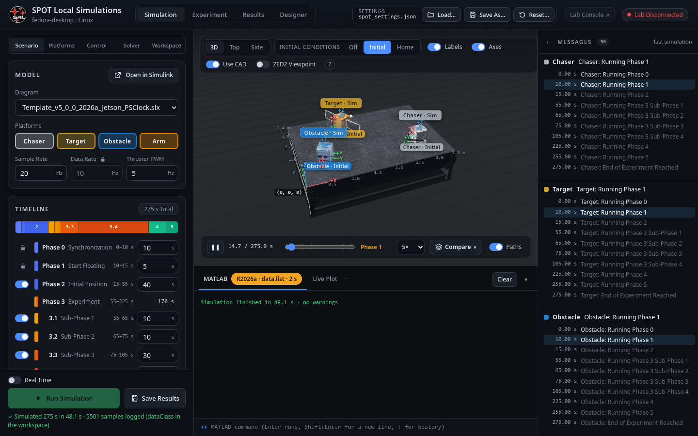

# SPOT: the Spacecraft Proximity Operations Testbed

Welcome. This wiki documents the **SPOT software**: the MATLAB/Simulink template, the **SPOT Console** (the web page you drive it from) and the code that runs on the laboratory hardware. It is written for someone who has never seen the code: every function has its own page that walks through its lines, and every tab of the console has a page with a screenshot.

## What SPOT is

SPOT is Carleton University's Spacecraft Robotics and Control Laboratory testbed: three air-bearing platforms that float on a 3.5 m × 2.4 m granite table and behave like spacecraft in a plane. Each platform carries eight cold-gas thrusters, a Jetson computer and a Teensy microcontroller that drives the thruster valves. A PhaseSpace motion-capture system measures where each platform is, and a Jetson TX2 ("the lab console") streams those measurements to the platforms. The Chaser also carries a three-joint robotic arm driven by Dynamixel servos.

| Name in the code | Name on screen | Role |
|---|---|---|
| `RED` | Chaser | The active spacecraft (it carries the arm and a ZED2 camera) |
| `BLACK` | Target | The spacecraft being approached (it carries the docking cone) |
| `BLUE` | Obstacle | A third platform that gets in the way |
| `ARM` | Arm | The Chaser's three-joint manipulator |

The same Simulink diagram does two jobs: **simulated** on your computer (the plant dynamics are computed in the diagram) and **compiled and deployed** to the platforms, where the same control code runs against the real hardware.

## Where to start

1. [[Getting Started|Getting-Started]]: install, create a project, run a simulation, run an experiment.
2. [[How It Fits Together|Architecture]]: the pieces (MATLAB, the console, the lab console, the platforms) and how they talk to each other.
3. [[The Simulink Diagram|Diagram-Overview]]: what runs each step, in what order.
4. The console, tab by tab: [[Simulation|Simulation-Tab]], [[Experiment|Experiment-Tab]], [[Results|Results-Tab]], [[Designer|Designer-Tab]], [[Calibration|Calibration-Tab]] (on both consoles), and the lab console's [[PhaseSpace|Lab-Console-PhaseSpace-Tab]] and [[Hardware|Lab-Console-Hardware-Tab]] tabs.
5. The maths: [[platform dynamics and LQR|Math-Platform-Dynamics-and-LQR]], [[the thruster mixer|Math-Thruster-Mixer]], [[mass properties|Math-Mass-Properties]], [[the arm|Math-Arm]].
6. The code, package by package, in the sidebar: every `spot.*` function, every console module, every hardware program.

## How the pages are organised

- **A page per function.** Each MATLAB function (`+spot/+package/name.m`) has a page named `spot-package-name` with: what it is for, how to call it, a line-by-line walkthrough, the equations it implements, who calls it and what it calls, and the code itself (collapsed at the bottom; the walkthrough's line numbers refer to it).
- **A page per module** for the console's Python server and JavaScript page, and for each hardware program, explained function by function.
- **A page per subsystem** of the diagram, with a picture of it.
- Pages about the console show the real page; they were captured from a running console with the default settings.

The line numbers and the "used by / uses" lists are generated from the code by `documentation/wiki/build_wiki.py` (see [[The Tutorial and This Wiki|Tool-Documentation]]), so they stay right when the code changes.

## Conventions

- **Units**: metres, seconds, kilograms, newtons, radians inside the code and the diagram; the settings file and the console show angles in **degrees**.
- **Frames**: the *table frame* has its origin at one corner of the table top, +x along the 3.5 m side, +y along the 2.4 m side, +z up. A platform's *body frame* has +x out of its front face (the one with the ZED2 camera on the Chaser).
- **Phases**: an experiment runs through phases 0 to 5; phase 3 (the experiment proper) has four sub-phases. See [[Settings File|Settings-File]] and [[1 - Experiment Logic|Diagram-1-Experiment-Logic]].
- Code paths are relative to the project folder (the folder with `SPOT.m`).
