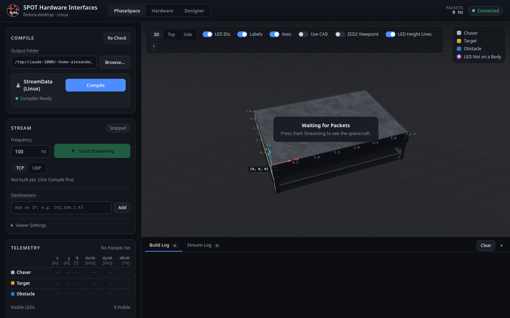

# Interactive Mode

Fly the platforms **without MATLAB and without a diagram**: switch a platform on, drag its goal marker on the lab console's 3D table, press **Fly to Goals**, and the lab console closes the loop with the template's own controller (its LQR law and thruster mixer, re-implemented in Python in [[control.py|Console-control]] and checked against the diagram by [[spot.control.verifyConsoleController|spot-control-verifyConsoleController]]). For positioning the platforms before an experiment, for demonstrations, and for checking that a platform flies at all. The card is on the lab console's [[PhaseSpace tab|Lab-Console-PhaseSpace-Tab]]; the code is [[interactive.js|Page-interactive-js]] and [[interactive.py|Console-interactive]].

## Using it

1. The cameras must be **streaming** and the platform **seen** by PhaseSpace, floating-ready on the table, with its Teensy free (**Ready** on the [[Hardware tab|Lab-Console-Hardware-Tab]]).
2. Switch the card's main toggle on, then a platform's row toggle. A goal marker appears where the platform is; **Here** puts it back there.
3. **Drag the marker** to where the platform should go (Shift+drag turns it). Goals stay 0.2 m inside the table's edges and at least 0.45 m from each other and from resting platforms; the hint line says when one is too close.
4. **Fly to Goals**: the pucks come on and the platform flies straight at its goal and holds it. Its row shows **Flying**, the error in millimetres and degrees, and the eight duty cycles as bars; the 3D view draws the thruster plumes. You can keep dragging the goal of a flying platform.
5. **Stop All** (or **Esc** on this tab) ends the flight; a platform's toggle off stops that one.

The **Controller** details show what the loop runs: the period (`baseRate`, 50 ms), each platform's mass, inertia and thrust, the LQR weights Q and R and the resulting gain K: SPOT's default settings, the same numbers as the Simulation tab's Control pane. The thrust is the exception: where the lab console has a thruster calibration for a platform ([[Calibration Tab|Calibration-Tab]]), Interactive Mode flies it with each thruster's calibrated thrust, and the details show their range, e.g. "thrust 0.250–0.310 N (calibrated)"; otherwise 0.2825 N per thruster. The step statistics (late steps, the loop's timing) are for checking that the TX2 keeps up.

## What stops a platform

The flight belongs to the page that started it (only that page moves goals or adds platforms; it keeps the flight alive with a heartbeat every 0.5 s); any page can stop it. A platform stops when its toggle goes off, the Hardware tab switches it off, PhaseSpace **loses it** for 1 s (its thrusters are off after 0.25 s), it is seen off the table, an experiment starts, another program opens its Teensy, or its controller process stops answering. The whole flight stops on Stop All, Esc, three missed heartbeats (the page was closed) or a console shutdown; and each Teensy's own 2 s watchdog is the last line. A toast names each platform that stopped and why.

The controller flies each platform straight at its goal with no knowledge of the others: crossing paths are for whoever places the goals.
