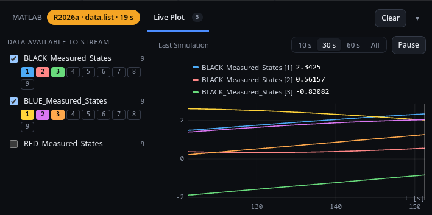

# liveplot.js

**File:** `+spot/+console/webapp/static/liveplot.js` · **MATLAB side:** [[spot.hardware.liveStream|spot-hardware-liveStream]], [[spot.sim.liveData|spot-sim-liveData]]; **lab console:** [[experiment.py|Console-experiment]]

<!-- source: +spot/+console/webapp/static/liveplot.js -->

## What it is for

The **Live Plot** tab of the MATLAB console: a plot of the signals the diagram's Live Stream blocks send. On the Simulation tab, the simulation's streams, live while it runs (best with Real Time on), then the whole run with the replay's time marked; on the Experiment tab, the platforms' streams as the lab console receives them. "Data available to stream" lists every stream (named after what is connected to its block); tick one to plot it and pick its elements with the [1] [2] … chips.



## Function by function

**Lines 11–26.** The palette, the time windows (10 / 30 / 60 s / All), 12 000 samples kept per stream, the state (the mode, the simulation's and the experiment's streams as maps, the selection and window from storage).

**Lines 29–48.** The MATLAB / Live Plot tabs (`data-ctab`): show one or the other, remembered; *Clear* on the plot tab empties the data.

**Lines 51–68.** The window buttons and Pause (hold the plot while data keeps arriving).

**Lines 70–93.** The stream list: ticking a stream selects its first three elements (or all when ≤ 3); the chips toggle elements; the selection is saved.

**Lines 96–120.** Storing samples: a stream (re)starts if its width changes; `append` keeps the last 12 000; `rowsOf` copes with MATLAB's JSON (a single sample arrives as a number and a flat array); `simStream` keys simulation streams by name.

**Lines 122–184.** The API: `show(mode)` (hide the tab on the Results page and bring it back after; load the experiment's streams the first time), `simStarted`/`simData`/`simResult`/`simTime` (the simulation's samples live and at the end, and the replay time), `experiment` (the lab console's stream list; a new start clears them) and `experimentData` (new rows from the lab console).

**Lines 186–197.** `loadExperiment`: what the lab console kept so far, for a page opened mid-experiment.

**Lines 201–229.** `renderList`: the stream list with its count and source, or a hint when there are none.

**Lines 232–352.** Drawing on the canvas: the lines to draw (`series`), nice tick steps, binary search; `draw`: size for the device pixel ratio; the time range (the window ending at the newest sample, held when paused, or following the replay); the value range over what is shown with 6 % padding; grid and tick labels; each line thinned to about one point per pixel, pen lifted at NaN; the replay's time and the hover's time as vertical marks; the legend with each line's value at the hover (or the replay time, or the newest).

**Lines 354–365.** Hover handling; an animation-frame loop that redraws only when the tab is visible and something changed; a resize observer.

## The code
<!-- listing -->
<details>
<summary><b>+spot/+console/webapp/static/liveplot.js</b> (366 lines; click to show)</summary>

```javascript
   1  // Live Plot (local console): a tab of the MATLAB command window that plots the signals the
   2  // diagram's Live Stream blocks send (the "Live Data Streams" subsystem, spot.hardware.liveStream).
   3  //   Simulation tab: the simulation's streams, live while it runs (best with Real time on), then
   4  //                   the whole run with the replay's time marked.
   5  //   Experiment tab: the platforms' streams as the lab console receives them (UDP 55011-55013).
   6  // "Data available to stream" lists every stream (named after what is connected to its block);
   7  // tick one to plot it, and pick its elements with the [1] [2] ... chips.
   8  
   9  import { platformName } from './platforms.js';
  10  
  11  const PALETTE = ['#4dabf7', '#ff8787', '#69db7c', '#ffd43b', '#da77f2', '#ffa94d', '#3bc9db', '#f783ac'];
  12  const WINDOWS = [['10', 10], ['30', 30], ['60', 60], ['All', 0]];
  13  const KEEP = 12000;   // samples kept per stream in the page
  14  const list = x => (Array.isArray(x) ? x : x == null ? [] : [x]);
  15  const esc = s => String(s == null ? '' : s).replace(/[&<>"]/g, c => ({ '&': '&amp;', '<': '&lt;', '>': '&gt;', '"': '&quot;' }[c]));
  16  const $ = s => document.querySelector(s);
  17  
  18  export function initLivePlot({ api, storage }) {
  19    const S = {
  20      mode: 'simulation', tab: storage.get('spot.console.tab', 'cmd'),
  21      sim: new Map(), simLive: false, simT: null,
  22      exp: new Map(), expStarted: null, expLoaded: false,
  23      sel: storage.get('spot.live.sel', {}),   // { 'sim:NAME' | 'exp:PLAT/NAME': [element indexes] }
  24      win: storage.get('spot.live.window', 30), paused: false, hover: null, dirty: true,
  25    };
  26    const consoleEl = $('#matlabConsole'), canvas = $('#liveCanvas'), ctx = canvas.getContext('2d');
  27  
  28    // ---------------------------------------------------------------- tabs (MATLAB | Live Plot)
  29    function setTab(tab, remember = true) {
  30      S.tab = tab;
  31      consoleEl.dataset.tab = tab;
  32      for (const b of document.querySelectorAll('[data-ctab]')) {
  33        b.classList.toggle('active', b.dataset.ctab === tab);
  34        b.setAttribute('aria-selected', String(b.dataset.ctab === tab));
  35      }
  36      $('#livePane').hidden = tab !== 'plot';
  37      $('.matlab-body .cmdwin').hidden = tab === 'plot';
  38      $('#cmdClear').title = tab === 'plot' ? 'Clear the plotted data' : 'Clear the command window';
  39      if (remember) storage.set('spot.console.tab', tab);
  40      S.dirty = true;
  41    }
  42    for (const b of document.querySelectorAll('[data-ctab]')) b.onclick = () => { S.restorePlot = false; setTab(b.dataset.ctab); };
  43    $('#cmdClear').addEventListener('click', () => {
  44      if (S.tab !== 'plot') return;
  45      (S.mode === 'simulation' ? S.sim : S.exp).forEach(s => { s.t = []; s.v = []; });
  46      S.dirty = true;
  47    });
  48    setTab(S.tab);
  49  
  50    // ---------------------------------------------------------------- the controls
  51    $('#liveWindow').innerHTML = WINDOWS.map(([label, w]) =>
  52      `<button type="button" data-win="${w}" title="${w ? `The last ${w} s` : 'Everything received'}">${label === 'All' ? 'All' : `${label} s`}</button>`).join('');
  53    $('#liveWindow').onclick = ev => {
  54      const b = ev.target.closest('[data-win]');
  55      if (!b) return;
  56      S.win = Number(b.dataset.win);
  57      storage.set('spot.live.window', S.win);
  58      renderControls();
  59    };
  60    $('#livePause').onclick = () => { S.paused = !S.paused; renderControls(); };
  61    function renderControls() {
  62      for (const b of $('#liveWindow').children) b.classList.toggle('active', Number(b.dataset.win) === S.win);
  63      $('#livePause').textContent = S.paused ? 'Resume' : 'Pause';
  64      $('#livePause').title = S.paused ? 'Follow the data again' : 'Hold the plot where it is (data keeps arriving)';
  65      S.dirty = true;
  66    }
  67    renderControls();
  68  
  69    // The stream list: tick a stream to plot it; its chips choose the elements
  70    $('#liveStreams').addEventListener('change', ev => {
  71      const box = ev.target.closest('input[data-id]');
  72      if (!box) return;
  73      const st = streams().find(s => s.id === box.dataset.id);
  74      if (box.checked) S.sel[box.dataset.id] = st && st.n > 3 ? [0, 1, 2] : [...Array(st ? st.n : 1).keys()];
  75      else delete S.sel[box.dataset.id];
  76      saveSel();
  77    });
  78    $('#liveStreams').addEventListener('click', ev => {
  79      const chip = ev.target.closest('[data-el]');
  80      if (!chip) return;
  81      const id = chip.closest('[data-stream]').dataset.stream;
  82      const k = Number(chip.dataset.el);
  83      const on = new Set(S.sel[id] || []);
  84      on.has(k) ? on.delete(k) : on.add(k);
  85      if (on.size) S.sel[id] = [...on].sort((a, b) => a - b);
  86      else delete S.sel[id];
  87      saveSel();
  88    });
  89    function saveSel() {
  90      storage.set('spot.live.sel', S.sel);
  91      renderList();
  92      S.dirty = true;
  93    }
  94  
  95    // ---------------------------------------------------------------- data in
  96    function store(map, id, fields) {
  97      let s = map.get(id);
  98      if (!s || s.n !== fields.n) {
  99        s = { id, t: [], v: [], ...fields };
 100        map.set(id, s);
 101        S.listDirty = true;
 102      }
 103      return s;
 104    }
 105    function append(s, t, rows) {
 106      for (let k = 0; k < t.length; k++) { s.t.push(t[k]); s.v.push(rows[k]); }
 107      if (s.t.length > KEEP) { s.t.splice(0, s.t.length - KEEP); s.v.splice(0, s.v.length - KEEP); }
 108    }
 109    // MATLAB's JSON: t is a number for one sample; v a flat array for one sample or one column
 110    function rowsOf(t, v) {
 111      const ts = list(t);
 112      if (!Array.isArray(t)) return [ts, [list(v)]];
 113      const vs = list(v);
 114      return [ts, vs.length && !Array.isArray(vs[0]) ? vs.map(x => [x]) : vs];
 115    }
 116    function simStream(m) {
 117      const [t, rows] = rowsOf(m.t, m.v);
 118      const n = rows.length ? rows[0].length : 1;
 119      return [store(S.sim, `sim:${m.name}`, { name: m.name, platform: '', n }), t, rows];
 120    }
 121  
 122    const api_ = {
 123      show(mode) {
 124        // The page shown: 'simulation' or 'experiment'; null on a page without the Live Plot tab
 125        // (Results), which shows the command window and brings the plot back on the way out
 126        $('[data-ctab="plot"]').hidden = !mode;
 127        if (!mode) {
 128          if (S.tab === 'plot') { S.restorePlot = true; setTab('cmd', false); }
 129          return;
 130        }
 131        if (S.restorePlot) { S.restorePlot = false; setTab('plot', false); }
 132        if (mode === S.mode && S.shownOnce) return;
 133        S.mode = mode;
 134        S.shownOnce = true;
 135        if (mode === 'experiment' && !S.expLoaded) loadExperiment();
 136        S.listDirty = true;
 137        S.dirty = true;
 138      },
 139      simStarted() {
 140        S.sim = new Map();
 141        S.simLive = true;
 142        S.simT = null;
 143        S.listDirty = S.dirty = true;
 144      },
 145      simData(streams) {
 146        // New samples during a simulation (the worker's sim_live event)
 147        for (const m of list(streams)) {
 148          const [s, t, rows] = simStream(m);
 149          append(s, t, rows);
 150        }
 151        S.dirty = true;
 152      },
 153      simResult(live) {
 154        // The finished simulation's streams (thinned to a few thousand samples each)
 155        S.sim = new Map();
 156        for (const m of list(live)) {
 157          const [s, t, rows] = simStream(m);
 158          append(s, t, rows);
 159        }
 160        S.simLive = false;
 161        S.listDirty = S.dirty = true;
 162      },
 163      simTime(t) {
 164        S.simT = t;
 165        if (S.mode === 'simulation' && !S.simLive) S.dirty = true;
 166      },
 167      experiment(exp) {
 168        // The lab console's experiment status: its list of streams, and a new start clears them
 169        if (!exp) return;
 170        if (exp.started && exp.started !== S.expStarted) {
 171          if (S.expStarted !== null) S.exp = new Map();
 172          S.expStarted = exp.started;
 173        }
 174        for (const l of list(exp.live)) store(S.exp, `exp:${l.key}`, { name: l.name, platform: l.platform, n: l.n });
 175      },
 176      experimentData(batch) {
 177        // New samples from the lab console (its live_data event)
 178        for (const [key, b] of Object.entries(batch || {})) {
 179          const s = store(S.exp, `exp:${key}`, { name: b.name, platform: b.platform, n: b.n });
 180          append(s, b.rows.map(r => r[0]), b.rows.map(r => r.slice(1)));
 181        }
 182        S.dirty = true;
 183      },
 184    };
 185  
 186    async function loadExperiment() {
 187      // What the lab console has kept so far (a page opened during an experiment)
 188      S.expLoaded = true;
 189      try {
 190        const r = await api('/api/lab', { path: 'experiment/live' });
 191        for (const [key, b] of Object.entries((r.result || {}).streams || {})) {
 192          const s = store(S.exp, `exp:${key}`, { name: b.name, platform: b.platform, n: b.n });
 193          if (!s.t.length) append(s, b.rows.map(x => x[0]), b.rows.map(x => x.slice(1)));
 194        }
 195        S.listDirty = S.dirty = true;
 196      } catch { S.expLoaded = false; /* the lab console isn't reachable (or older): retried later */ }
 197    }
 198  
 199    // ---------------------------------------------------------------- the stream list
 200    const streams = () => [...(S.mode === 'simulation' ? S.sim : S.exp).values()]
 201      .sort((a, b) => (a.platform + a.name).localeCompare(b.platform + b.name));
 202    const selected = () => streams().filter(s => S.sel[s.id]);
 203  
 204    function renderList() {
 205      S.listDirty = false;
 206      const all = streams();
 207      $('#liveCount').textContent = all.length ? String(all.length) : '';
 208      $('#liveSource').textContent = S.mode === 'simulation' ? (S.simLive ? 'Simulation Running' : 'Last Simulation')
 209        : 'From the Platforms';
 210      if (!all.length) {
 211        $('#liveStreams').innerHTML = `<p class="live-none">${S.mode === 'simulation'
 212          ? 'No streams yet. Run a simulation of a diagram with a <b>Live Data Streams</b> subsystem: each Live Stream block in it appears here, named after what is connected to it.'
 213          : 'No streams yet. They appear while an experiment runs, from the Live Stream blocks of its diagram.'}</p>`;
 214        return;
 215      }
 216      let colour = 0;
 217      $('#liveStreams').innerHTML = all.map(s => {
 218        const on = S.sel[s.id];
 219        const chips = on && s.n > 1 ? `<div class="live-els">${[...Array(s.n).keys()].map(k => {
 220          const c = on.includes(k) ? PALETTE[colour++ % PALETTE.length] : '';
 221          return `<button type="button" class="live-el${c ? ' on' : ''}" data-el="${k}" style="${c ? `--c:${c}` : ''}" title="Element ${k + 1} of ${s.n}">${k + 1}</button>`;
 222        }).join('')}</div>` : on ? (colour++, '') : '';
 223        return `<div class="live-stream" data-stream="${esc(s.id)}">
 224          <label class="live-check" title="${esc(s.name)}${s.platform ? ` from the ${platformName(s.platform)}` : ''} · ${s.n} value${s.n === 1 ? '' : 's'} per sample">
 225            <input type="checkbox" data-id="${esc(s.id)}" ${on ? 'checked' : ''}>
 226            <span class="live-name">${esc(s.name)}</span>${s.platform ? `<span class="live-plat">${esc(platformName(s.platform))}</span>` : ''}
 227            <span class="live-n">${s.n}</span></label>${chips}</div>`;
 228      }).join('');
 229    }
 230  
 231    // ---------------------------------------------------------------- drawing
 232    function series() {
 233      // The lines to draw: [{ s, k, colour, label }]
 234      const out = [];
 235      let colour = 0;
 236      for (const s of selected()) {
 237        for (const k of S.sel[s.id].filter(k => k < s.n)) {
 238          out.push({ s, k, colour: PALETTE[colour++ % PALETTE.length],
 239                     label: `${s.platform ? platformName(s.platform) + ' · ' : ''}${s.name}${s.n > 1 ? ` [${k + 1}]` : ''}` });
 240        }
 241      }
 242      return out;
 243    }
 244    function nice(span, ticks) {
 245      const raw = span / ticks, p = Math.pow(10, Math.floor(Math.log10(raw)));
 246      return [1, 2, 2.5, 5, 10].map(m => m * p).find(step => step >= raw) || raw;
 247    }
 248    function lowerBound(arr, x) {
 249      let lo = 0, hi = arr.length;
 250      while (lo < hi) { const mid = (lo + hi) >> 1; if (arr[mid] < x) lo = mid + 1; else hi = mid; }
 251      return lo;
 252    }
 253  
 254    function draw() {
 255      S.dirty = false;
 256      const dpr = Math.min(window.devicePixelRatio || 1, 2);
 257      const w = canvas.clientWidth, h = canvas.clientHeight;
 258      if (!w || !h) return;
 259      if (canvas.width !== Math.round(w * dpr) || canvas.height !== Math.round(h * dpr)) {
 260        canvas.width = Math.round(w * dpr); canvas.height = Math.round(h * dpr);
 261      }
 262      ctx.setTransform(dpr, 0, 0, dpr, 0, 0);
 263      ctx.clearRect(0, 0, w, h);
 264      const lines = series();
 265      const empty = $('#liveEmpty');
 266      empty.hidden = lines.length > 0;
 267      if (!lines.length) {
 268        empty.textContent = streams().length ? 'Tick a stream on the left to plot it.' : '';
 269        $('#liveLegend').innerHTML = '';
 270        return;
 271      }
 272      // Time range: the window, ending at the newest sample (or the replay's time, or held)
 273      let tEnd = -Infinity, tStart = Infinity;
 274      for (const { s } of lines) if (s.t.length) { tEnd = Math.max(tEnd, s.t[s.t.length - 1]); tStart = Math.min(tStart, s.t[0]); }
 275      if (!isFinite(tEnd)) { tEnd = 1; tStart = 0; }
 276      const replay = S.mode === 'simulation' && !S.simLive && S.simT != null;
 277      if (S.paused && S.held) tEnd = S.held;
 278      else if (replay && S.win) tEnd = Math.max(S.simT, tStart + S.win);
 279      S.held = tEnd;
 280      const x0 = S.win ? tEnd - S.win : tStart, x1 = Math.max(tEnd, x0 + 1e-6);
 281      // Value range over what is shown
 282      let y0 = Infinity, y1 = -Infinity;
 283      for (const { s, k } of lines) {
 284        for (let i = Math.max(0, lowerBound(s.t, x0) - 1); i < s.t.length && s.t[i] <= x1; i++) {
 285          const y = s.v[i][k];
 286          if (y != null && isFinite(y)) { if (y < y0) y0 = y; if (y > y1) y1 = y; }
 287        }
 288      }
 289      if (!isFinite(y0)) { y0 = -1; y1 = 1; }
 290      if (y1 - y0 < 1e-9) { y0 -= 1; y1 += 1; }
 291      const pad = (y1 - y0) * 0.06; y0 -= pad; y1 += pad;
 292      const L = 58, R = 12, T = 10, B = 24, pw = w - L - R, ph = h - T - B;
 293      const X = t => L + (t - x0) / (x1 - x0) * pw, Y = y => T + (1 - (y - y0) / (y1 - y0)) * ph;
 294      // Grid and ticks
 295      ctx.font = '11px ui-monospace, monospace';
 296      ctx.strokeStyle = 'rgba(255,255,255,0.07)'; ctx.fillStyle = '#8d96a6'; ctx.lineWidth = 1;
 297      const ys = nice(y1 - y0, Math.max(2, Math.floor(ph / 40)));
 298      ctx.textAlign = 'right'; ctx.textBaseline = 'middle';
 299      for (let y = Math.ceil(y0 / ys) * ys; y <= y1; y += ys) {
 300        ctx.beginPath(); ctx.moveTo(L, Y(y)); ctx.lineTo(L + pw, Y(y)); ctx.stroke();
 301        ctx.fillText(Math.abs(y) < ys * 1e-6 ? '0' : Number(y.toPrecision(4)).toString(), L - 6, Y(y));
 302      }
 303      const xs = nice(x1 - x0, Math.max(2, Math.floor(pw / 80)));
 304      ctx.textAlign = 'center'; ctx.textBaseline = 'top';
 305      for (let x = Math.ceil(x0 / xs) * xs; x <= x1; x += xs) {
 306        ctx.beginPath(); ctx.moveTo(X(x), T); ctx.lineTo(X(x), T + ph); ctx.stroke();
 307        ctx.fillText(`${Number(x.toPrecision(5))}`, X(x), T + ph + 5);
 308      }
 309      ctx.textAlign = 'right';
 310      ctx.fillText('t [s]', L + pw, T + ph + 5 - 14);
 311      // The lines (thinned to about one point per pixel)
 312      ctx.save();
 313      ctx.beginPath(); ctx.rect(L, T, pw, ph); ctx.clip();
 314      for (const { s, k, colour } of lines) {
 315        const i0 = Math.max(0, lowerBound(s.t, x0) - 1), i1 = Math.min(s.t.length, lowerBound(s.t, x1) + 1);
 316        const step = Math.max(1, Math.floor((i1 - i0) / (pw * 1.5)));
 317        ctx.strokeStyle = colour; ctx.lineWidth = 1.6; ctx.beginPath();
 318        let pen = false;
 319        for (let i = i0; i < i1; i += step) {
 320          const y = s.v[i][k];
 321          if (y == null || !isFinite(y)) { pen = false; continue; }
 322          if (pen) ctx.lineTo(X(s.t[i]), Y(y)); else { ctx.moveTo(X(s.t[i]), Y(y)); pen = true; }
 323        }
 324        ctx.stroke();
 325      }
 326      // The replay's time, and the hover readout's time
 327      const mark = (t, colour, dash) => {
 328        if (t == null || t < x0 || t > x1) return;
 329        ctx.strokeStyle = colour; ctx.setLineDash(dash); ctx.lineWidth = 1;
 330        ctx.beginPath(); ctx.moveTo(X(t), T); ctx.lineTo(X(t), T + ph); ctx.stroke(); ctx.setLineDash([]);
 331      };
 332      if (replay) mark(S.simT, 'rgba(255,255,255,0.55)', []);
 333      const ht = S.hover != null ? x0 + (S.hover - L) / pw * (x1 - x0) : null;
 334      if (ht != null && ht >= x0 && ht <= x1) mark(ht, 'rgba(255,212,59,0.7)', [4, 3]);
 335      ctx.restore();
 336      // Legend, with the values at the hover (or the newest / replay time)
 337      const at = ht != null && ht >= x0 && ht <= x1 ? ht : replay ? S.simT : null;
 338      $('#liveLegend').innerHTML = lines.map(({ s, k, colour, label }) => {
 339        let val = '';
 340        if (s.t.length) {
 341          let i = s.t.length - 1;
 342          if (at != null) {   // the last sample at or before that time
 343            i = lowerBound(s.t, at);
 344            if (i >= s.t.length || s.t[i] > at) i -= 1;
 345            i = Math.max(0, i);
 346          }
 347          const y = s.v[i][k];
 348          val = y == null || !isFinite(y) ? '—' : Number(y.toPrecision(5)).toString();
 349        }
 350        return `<span><i style="background:${colour}"></i>${esc(label)}<b class="mono">${val}</b></span>`;
 351      }).join('') + (at != null ? `<span class="live-at mono">t = ${at.toFixed(2)} s</span>` : '');
 352    }
 353  
 354    canvas.addEventListener('mousemove', ev => { S.hover = ev.offsetX; S.dirty = true; });
 355    canvas.addEventListener('mouseleave', () => { S.hover = null; S.dirty = true; });
 356  
 357    (function frame() {
 358      if (S.tab === 'plot' && !consoleEl.classList.contains('collapsed') && consoleEl.offsetParent) {
 359        if (S.listDirty) renderList();
 360        if (S.dirty) draw();
 361      }
 362      requestAnimationFrame(frame);
 363    })();
 364    new ResizeObserver(() => { S.dirty = true; }).observe(canvas);
 365    return api_;
 366  }
```

</details>
<!-- /listing -->
