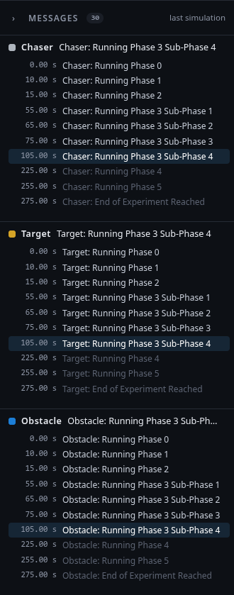

# messages.js

**File:** `+spot/+console/webapp/static/messages.js` · **MATLAB side:** [[spot.hardware.debugMessages|spot-hardware-debugMessages]], [[spot.sim.debugLog|spot-sim-debugLog]]

<!-- source: +spot/+console/webapp/static/messages.js -->

## What it is for

The Messages panel: each platform's debug message, the text the diagram writes to `RED_Logger` / `BLACK_Logger` / `BLUE_Logger` ("Chaser: Running Phase 1"). One panel, moved into whichever page is shown (like the 3D view), with a column per platform. On the Simulation tab it shows the last simulation's messages (live while it runs; the playback highlights the one in effect at its time, so a simulation shows what an experiment will show); on the Experiment tab the platforms' messages as the lab console receives them. Only changes are listed, with how often a message was repeated.



## Function by function

**Lines 17–25.** State: the mode, the simulation's log (live flag, playback time), the experiment's log, which platforms take part.

**Lines 28–38.** `setCollapsed`: tuck the panel away (the 3D view takes the room), remembered in the browser.

**Lines 41–51.** `simEntries`: the finished simulation's record (`{NAME: {t: [], text: []}}`) as rows.

**Lines 53–101.** The API the app calls: `show(mode)` moves the panel into that page's slot; `setSelected` greys platforms not in the run; `simStarted`/`simMessages`/`simResult` fill the simulation's log live and at the end; `simTime` highlights the message in effect; `experiment` takes the lab console's `debug` entries and whether it is running.

**Lines 107–151.** `render`: per platform the last 500 rows (time or clock, text, ×count), an empty-state text, the current message in the header, a "silent for N s" warning during an experiment, auto-scroll; the total count; in a simulation the highlight, in a live experiment the newest row is current.

**Lines 153–178.** `highlight`: rows after the playback time are faint, the last one at or before it is current and scrolled into view, and its text goes in the header.

## The code
<!-- listing -->
<details>
<summary><b>+spot/+console/webapp/static/messages.js</b> (185 lines; click to show)</summary>

```javascript
   1  // Messages panel (local console): each platform's debug messages, the text the diagram writes to
   2  // RED_Logger / BLACK_Logger / BLUE_Logger (e.g. "Chaser: Running Phase 1"). One panel, moved into
   3  // the page shown like the 3D view, split into the Chaser (RED), Target (BLACK) and Obstacle (BLUE).
   4  //   Simulation tab: the messages of the last simulation (recorded by spot.hardware.debugMessages
   5  //                   while it ran, shown live during the run); the playback highlights the one
   6  //                   in effect at its time, so a simulation shows what an experiment will show.
   7  //   Experiment tab: the platforms' messages as the lab console receives them (UDP 55001-55003).
   8  // Only changes are listed (the platforms repeat the current message), with how often it came.
   9  
  10  import { PLATFORM_KEYS as PLATFORMS, COLORS as SWATCH } from './platforms.js';
  11  
  12  const MAX_ROWS = 500;
  13  const esc = s => String(s == null ? '' : s).replace(/[&<>"]/g, c => ({ '&': '&amp;', '<': '&lt;', '>': '&gt;', '"': '&quot;' }[c]));
  14  const list = x => (Array.isArray(x) ? x : x == null ? [] : [x]);
  15  const $ = s => document.querySelector(s);
  16  
  17  export function initMessages({ storage }) {
  18    const panel = $('#msgPanel');
  19    const S = {
  20      mode: 'simulation',
  21      sim: emptyLog(), simLive: false, simT: null,
  22      exp: emptyLog(), expRunning: false,
  23      selected: { RED: true, BLACK: true, BLUE: true },
  24    };
  25    function emptyLog() { return { RED: [], BLACK: [], BLUE: [] }; }
  26  
  27    // ---------------------------------------------------------------- tucking it away
  28    function setCollapsed(on) {
  29      panel.classList.toggle('collapsed', on);
  30      for (const slot of document.querySelectorAll('[data-msg-slot]')) slot.classList.toggle('collapsed', on);
  31      $('#msgToggle').setAttribute('aria-expanded', String(!on));
  32      $('#msgToggle').textContent = on ? '‹' : '›';
  33      $('#msgToggle').title = on ? 'Show the platforms\' messages' : 'Tuck the messages away (more room for the 3D view)';
  34      storage.set('spot.msgCollapsed', on);
  35      window.dispatchEvent(new Event('resize'));   // the 3D view takes the room
  36    }
  37    $('#msgToggle').onclick = () => setCollapsed(!panel.classList.contains('collapsed'));
  38    setCollapsed(storage.get('spot.msgCollapsed', false));
  39  
  40    // ---------------------------------------------------------------- data in
  41    function simEntries(debug) {
  42      // spot.sim.results' debug: { NAME: { t: [...], text: [...] } } (MATLAB may unwrap one entry)
  43      const out = emptyLog();
  44      for (const n of PLATFORMS) {
  45        const d = (debug || {})[n];
  46        if (!d) continue;
  47        const t = list(d.t), text = list(d.text);
  48        out[n] = t.map((tk, k) => ({ t: tk, text: text[k], count: 1 }));
  49      }
  50      return out;
  51    }
  52  
  53    const api = {
  54      show(mode) {
  55        // The page shown: 'simulation' or 'experiment'
  56        S.mode = mode;
  57        const slot = document.querySelector(`[data-msg-slot="${mode}"]`);
  58        if (slot && panel.parentElement !== slot) slot.append(panel);
  59        render();
  60      },
  61      setSelected(platforms) {
  62        // The settings' platforms: the others are shown as not taking part
  63        S.selected = { RED: Boolean(platforms && platforms.RED), BLACK: Boolean(platforms && platforms.BLACK),
  64                       BLUE: Boolean(platforms && platforms.BLUE) };
  65        render();
  66      },
  67      simStarted() {
  68        // A new simulation: its messages arrive while it runs
  69        S.sim = emptyLog();
  70        S.simLive = true;
  71        S.simT = null;
  72        if (S.mode === 'simulation') render();
  73      },
  74      simMessages(messages) {
  75        // New messages during a simulation: [{ platform, t, text }]
  76        for (const m of list(messages)) {
  77          const rows = S.sim[m.platform];
  78          if (rows) rows.push({ t: m.t, text: m.text, count: 1 });
  79        }
  80        if (S.mode === 'simulation') render();
  81      },
  82      simResult(debug) {
  83        // The finished simulation's full record
  84        S.sim = simEntries(debug);
  85        S.simLive = false;
  86        if (S.mode === 'simulation') render();
  87      },
  88      simTime(t) {
  89        // Playback time: highlight the message in effect
  90        S.simT = t;
  91        if (S.mode === 'simulation') highlight();
  92      },
  93      experiment(exp) {
  94        // The lab console's experiment status (debug: { NAME: { entries, seen } })
  95        const d = (exp && exp.debug) || {};
  96        for (const n of PLATFORMS) S.exp[n] = list(d[n] && d[n].entries);
  97        S.expSeen = Object.fromEntries(PLATFORMS.map(n => [n, d[n] ? d[n].seen : null]));
  98        S.expRunning = Boolean(exp && ['starting', 'running'].includes(exp.phase));
  99        if (S.mode === 'experiment') render();
 100      },
 101    };
 102  
 103    // ---------------------------------------------------------------- drawing
 104    const fmtT = t => (t == null || !isFinite(t) ? '' : `${Number(t).toFixed(2)} s`);
 105    const fmtClock = sec => new Date(sec * 1000).toLocaleTimeString();
 106  
 107    function render() {
 108      const sim = S.mode === 'simulation';
 109      const log = sim ? S.sim : S.exp;
 110      $('#msgSource').textContent = sim ? (S.simLive ? 'simulation running' : 'last simulation') : (S.expRunning ? 'live from the platforms' : 'last experiment');
 111      let total = 0;
 112      for (const n of PLATFORMS) {
 113        const sec = panel.querySelector(`[data-plat="${n}"]`);
 114        const rows = log[n].slice(-MAX_ROWS);
 115        total += rows.length;
 116        const listEl = sec.querySelector('.msg-list');
 117        const atBottom = listEl.scrollHeight - listEl.scrollTop - listEl.clientHeight < 30;
 118        sec.classList.toggle('off', !S.selected[n] && !rows.length);
 119        if (!rows.length) {
 120          listEl.innerHTML = `<li class="msg-empty">${!S.selected[n] ? 'Not in this run.'
 121            : sim ? (S.simLive ? 'No message yet.' : 'No messages: run a simulation.')
 122            : 'No messages yet. They appear here while the experiment runs.'}</li>`;
 123        } else {
 124          listEl.innerHTML = rows.map((r, k) => {
 125            const when = r.t != null && isFinite(r.t) ? fmtT(r.t) : r.first ? fmtClock(r.first) : '';
 126            const count = r.count > 1 ? `<span class="msg-count" title="Received ${r.count} times in a row">×${r.count}</span>` : '';
 127            return `<li data-k="${k}" data-t="${r.t == null ? '' : r.t}"><span class="msg-t mono">${esc(when)}</span><span class="msg-text">${esc(r.text)}</span>${count}</li>`;
 128          }).join('');
 129        }
 130        const last = rows[rows.length - 1];
 131        const now = sec.querySelector('.msg-now');
 132        now.textContent = last ? last.text : '';
 133        now.title = last ? last.text : '';
 134        if (!sim && S.expSeen && S.expSeen[n] != null && S.expRunning) {
 135          sec.classList.toggle('stale', S.expSeen[n] > 3);
 136          sec.querySelector('.msg-seen').textContent = S.expSeen[n] > 3 ? `silent for ${Math.round(S.expSeen[n])} s` : '';
 137        } else {
 138          sec.classList.remove('stale');
 139          sec.querySelector('.msg-seen').textContent = '';
 140        }
 141        if (atBottom || S.mode === 'experiment') listEl.scrollTop = listEl.scrollHeight;
 142      }
 143      $('#msgCount').textContent = total ? String(total) : '';
 144      if (sim) highlight();
 145      else if (S.expRunning) {   // live: the newest message is the one in effect
 146        for (const ol of panel.querySelectorAll('.msg-list')) {
 147          const last = ol.lastElementChild;
 148          if (last && last.dataset.k !== undefined) last.classList.add('current');
 149        }
 150      }
 151    }
 152  
 153    function highlight() {
 154      // Simulation playback: the message in effect at the playback time, earlier ones normal,
 155      // later ones faint
 156      const t = S.simT;
 157      for (const n of PLATFORMS) {
 158        const items = panel.querySelectorAll(`[data-plat="${n}"] .msg-list li[data-k]`);
 159        let current = null;
 160        for (const li of items) {
 161          const tk = parseFloat(li.dataset.t);
 162          const future = t != null && !S.simLive && tk > t + 1e-9;
 163          li.classList.toggle('future', future);
 164          li.classList.remove('current');
 165          if (!future) current = li;
 166        }
 167        if (current && t != null && !S.simLive) {
 168          current.classList.add('current');
 169          const listEl = current.parentElement;
 170          const top = current.offsetTop - listEl.offsetTop;
 171          if (top < listEl.scrollTop || top > listEl.scrollTop + listEl.clientHeight - current.offsetHeight) {
 172            listEl.scrollTop = top - listEl.clientHeight / 2;
 173          }
 174          const now = panel.querySelector(`[data-plat="${n}"] .msg-now`);
 175          now.textContent = current.querySelector('.msg-text').textContent;
 176        }
 177      }
 178    }
 179  
 180    for (const n of PLATFORMS) {
 181      panel.querySelector(`[data-plat="${n}"] .swatch`).style.background = SWATCH[n];
 182    }
 183    render();
 184    return api;
 185  }
```

</details>
<!-- /listing -->
