# The Simulation Tab

The tab you spend most of your time in: the scenario and its settings on the left, the 3D table in the middle, and below it the MATLAB command window, the Live Plot and the Messages panel. Everything you type here is saved to `spot_settings.json` as you type and put into MATLAB's workspace, so the diagram, the console and your own scripts all see the same values. The code behind it is [[sim.js|Page-sim-js]] in the page and [[spot.params|spot-params]] / [[spot.sim|spot-sim]] in MATLAB.

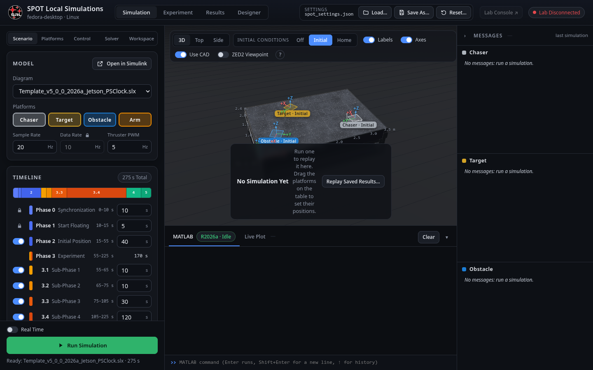

## The top bar

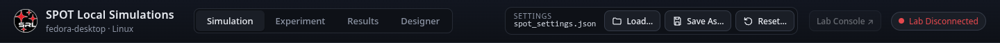

Left to right: the console's name (**SPOT Local Simulations**, or **SPOT Hardware Interfaces** on the lab console) and the project folder; the page tabs; **Load…** (open another settings file through MATLAB's file dialog), **Save As…**, **Reset…** (below); the link to the lab console's page; and the connection badge: on the local console it says whether the **lab console** is reachable, because that is what decides whether experiments can be run.

## The Scenario pane

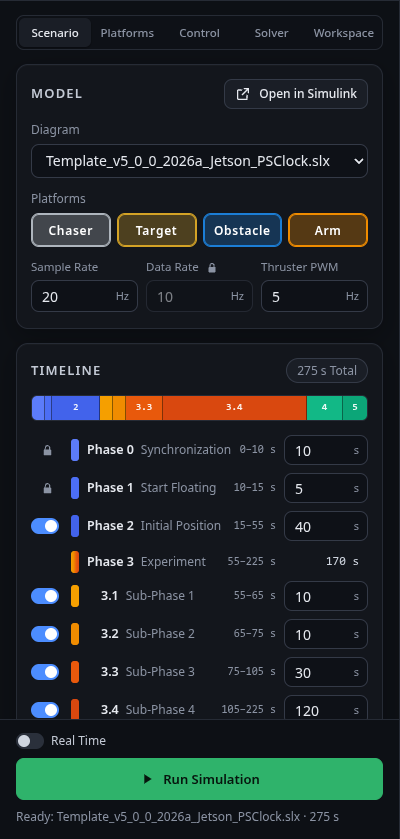

- **Diagram**: which `.slx` in the project folder to run, and **Open in Simulink** to look inside it. A new project has one.
- **Platforms**: tick the Chaser, Target, Obstacle and Arm that take part. The Arm is the Chaser's; ticking it also mounts it in the [[Designer|Designer-Tab]] (and vice versa). The combination becomes `platformSelection` ([[spot.params.platformSelection|spot-params-platformSelection]]), which tells the diagram which plants to simulate and the build which programs to make.
- **Sample Rate** (Hz): the diagram's step, `baseRate = 1/rate`. 20 Hz is the default and what the arm controllers are tuned for.
- **Data Rate** (Hz): the PhaseSpace stream's rate, i.e. how often a measurement changes; the simulation holds its measurements at this rate so the controller sees what it will see in the lab, and the Experiment tab starts the cameras at it. It is **locked** to the Sample Rate: click the padlock to set it separately (a dialog explains the consequences: a data rate below the sample rate gives the controller stale samples, above it wastes camera frames).

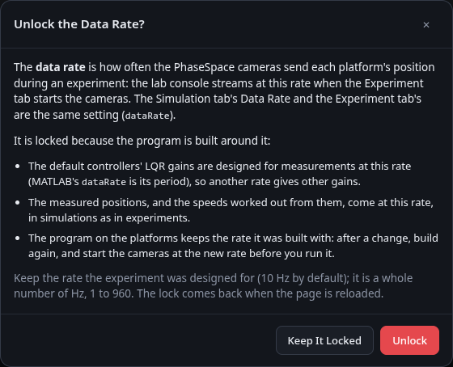

- **Thruster PWM** (Hz): the thrusters' PWM frequency, `PWMFreq`. It must match the Teensy firmware's fixed 5 Hz, so it is **locked** too: its padlock opens a dialog that explains why before it lets you change it.

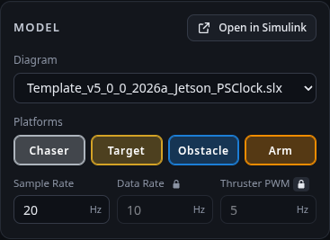

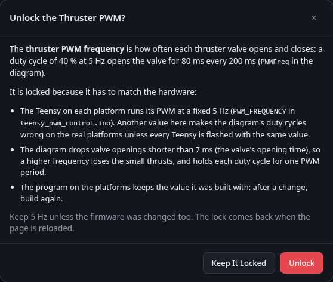

- **Calibrated Thrust**: use each thruster's measured thrust (the setting `calibration.thrusters`, on by default) in the diagram's [[thruster mixer|Math-Thruster-Mixer]], and so in the simulated plant, as the experiments' controller does: the eight thrusts the lab console's thruster calibration found ([[Calibration Tab|Calibration-Tab]]), as `F_thrusters_*` ([[Workspace Variables|Workspace-Variables]]). The line next to it says what the next simulation uses: **Used** (or **Not used**, switched off) for the platforms the project has a thruster calibration for, e.g. "Used for the Chaser.", or **Nominal: this project has no thruster calibration.** Off, or for a platform without one, every thruster has the Platforms pane's **Thrust**.

- **Calibrated Arm**: use the arm's measured joint friction and inertia (the setting `calibration.arm`, on by default) in the simulated arm (`armModel`, [[The Arm|Math-Arm]]): the lab console's arm calibration ([[Calibration Tab|Calibration-Tab]]), or a `resources/arm_calibration.json` copied by hand from [[calibrate_arm.py|Tool-calibrate-arm]], whichever was measured last. The line next to it says what the next simulation uses: **Used** with the file it came from, e.g. "Used: spot_calibration.json (arm), measured <date>.", **Not used** (switched off) with the date it was measured, or **Defaults: this project has no arm calibration.** Off, the arm has its model's defaults.

- **Table Slope**: simulate the table's measured slope (the setting `calibration.tableSlope`, on by default): while they float, the platforms slide downhill and their air bearings drag them, as the lab console's table slope calibration found ([[Calibration Tab|Calibration-Tab]]). The line next to it says what the next simulation uses: **Used** or **Not used**, with the tilt at the table's centre [mrad] and the date it was measured, or **Level** when the project has no table calibration (the Calibration tab's **Update from Lab** copies the lab's into `resources/spot_calibration.json`). Off, the table is level.

- **Timeline**: one row per phase ([[1 - Experiment Logic|Diagram-1-Experiment-Logic]]): a switch (phases 2, 3.1–3.4 and 4 can be skipped; 0, 1 and 5 always run), its name, when it runs and its **duration** in seconds. Below, a bar shows the whole run to scale and the **total time** `tsim`; skipped phases are hatched. Click a segment to toggle it.

## The Platforms pane

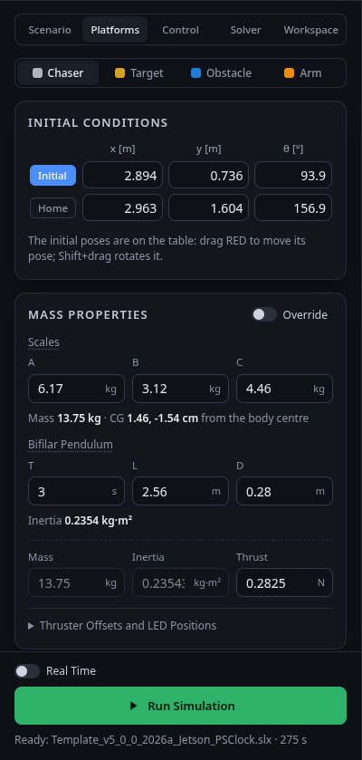

Pick a platform at the top (the chips), then:

- **Initial Conditions**: the **Initial** pose (where phase 2 drives it; also where the simulation starts) and the **Home** pose (phase 4), as x, y in metres and θ in degrees in the table frame. The **Initial** / **Home** buttons show the poses on the 3D table as markers you can **drag** (Shift+drag rotates); the toolbar's *Off / Initial / Home* switch does the same. For the Arm: its three initial joint angles.
- **Mass Properties**: the platform's mass and inertia are computed from what it carries ([[spot.massprops.compute|spot-massprops-compute]], [[Mass Properties|Math-Mass-Properties]]): the three scale readings of the **bifilar / three-scale test**, the dimensions, and the overrides if you have measured the mass and inertia directly. The pane shows the result: mass, centre of gravity, inertia, each thruster's lever arm about the CG (what the [[thruster mixer|Math-Thruster-Mixer]] uses) and the LED positions. **Thrust** is the nominal force of one thruster; when the project has a thruster calibration for the platform, a note under it gives the calibrated range and date, e.g. "Calibrated thrust used: 0.250–0.310 N, measured <date> (Calibration tab)." ("not used" with Calibrated Thrust off). **Write PhaseSpace Marker File** writes `tracker_positions_phasespace.txt`, the LED positions StreamData needs, for this CG.
- For the Arm: where it is mounted (from the Designer), its link lengths, masses and inertias ([[spot.arm.defaults|spot-arm-defaults]]).

## The Control pane

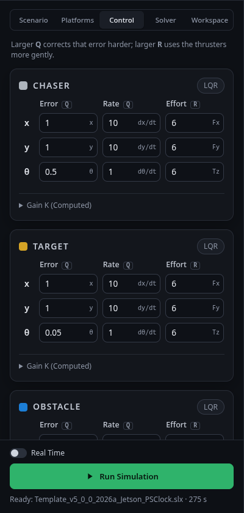

Per platform, the **LQR weights**: a row per axis (x, y, θ) with the weight on the position error, on the velocity error, and on the control effort (`Q` and `R`). The gain matrix **K** underneath is recomputed by MATLAB as you type ([[spot.control.lqrGains|spot-control-lqrGains]], [[Platform Dynamics and LQR|Math-Platform-Dynamics-and-LQR]]) and put in the workspace as `K_RED`, `K_BLACK`, `K_BLUE`, where the diagram's **Default LQR Control** reads it. A warning appears if the gains can't be computed (e.g. a zero weight).

With the **Arm** on, two more cards set its controllers (`control.ARM` in the settings, `armControl` in MATLAB, read by the diagram's *Default Position Control (ARM)* and *Default Velocity Control (ARM)*; see [[4 - Control|Diagram-4-Control]] and [[The Arm|Math-Arm]]):

| Position · Mode 1 | Velocity · Mode 3 |
|---|---|
| 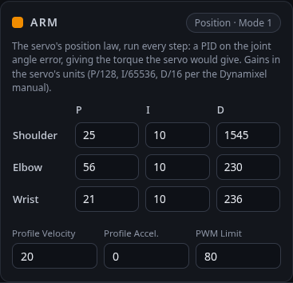 | 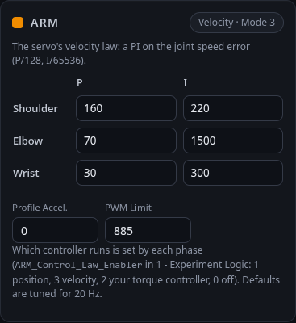 |

- **Position**: the servo's position law, a PID on the joint angle error, with a **P**, **I** and **D** gain per joint; the **Profile Velocity** (how fast the desired angle moves to the goal, in 0.229 rev/min; 0 = at once), the **Profile Acceleration** (214.577 rev/min²; 0 = none) and the **PWM Limit** (the most it asks of the motor, out of 885).
- **Velocity**: the servo's velocity law, a PI on the joint speed error (**P**, **I** per joint), with its profile acceleration and PWM limit.

The gains are in the servos' own units (the Dynamixel manual's P/128, I/65536, D/16), so values from the servo's control table mean the same thing here; the defaults are retuned for the diagram's 20 Hz. Which controller runs in each phase is set by `ARM_Control_Law_Enabler` in [[1 - Experiment Logic|Diagram-1-Experiment-Logic]] (1 position, 3 velocity, 2 your own torque controller, 0 off). A value out of range is outlined in red and not saved.

## The Solver pane

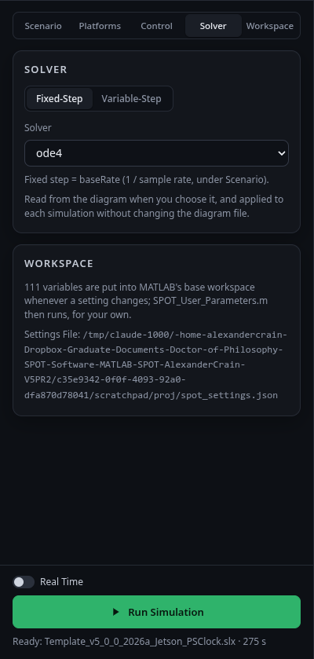

Fixed step (the default, `ode4` at `baseRate`: what the platforms run) or variable step with its tolerances. The diagram's own solver settings are read when a diagram is chosen ([[spot.sim.readSolver|spot-sim-readSolver]]); a simulation applies these without changing the file.

## The Workspace pane

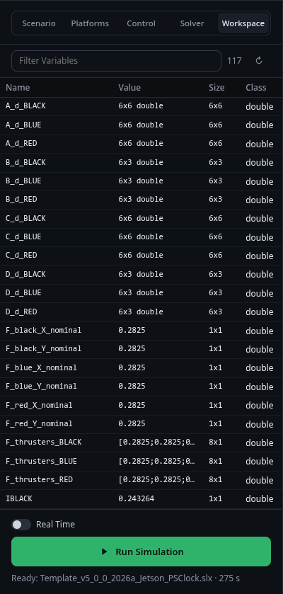

MATLAB's base workspace: every variable, filtered by the search box; click one to inspect it (a matrix as a table, a struct's fields to click into, a timeseries as a sparkline). After a run, `dataClass`, `dataPacket` and `simOut` are here ([[Workspace Variables|Workspace-Variables]]). The command window below takes MATLAB commands too.

## Running

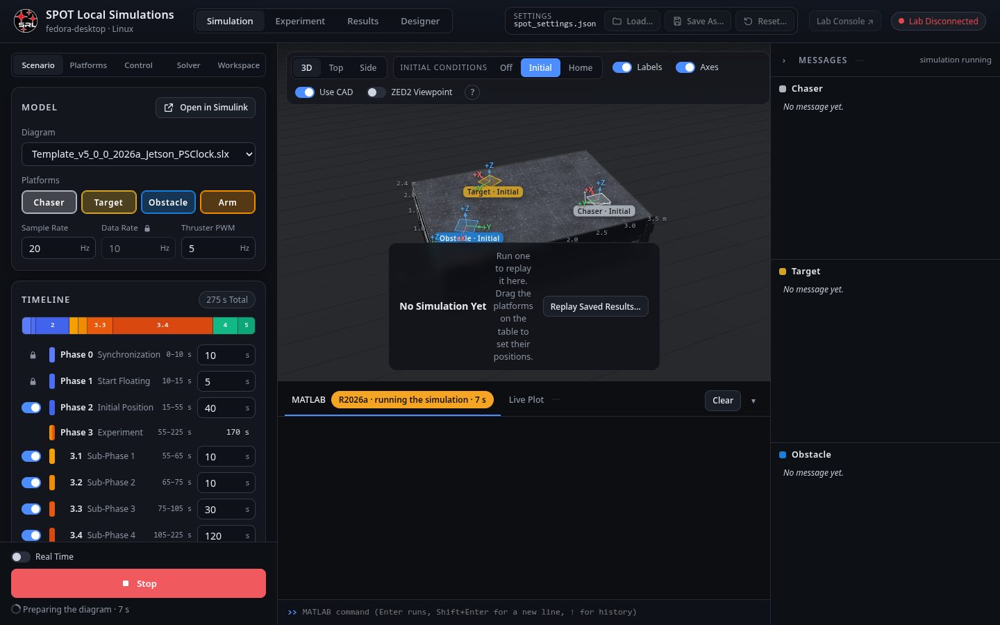

**Run Simulation** sends any pending edits, then runs the diagram in your MATLAB ([[spot.sim.run|spot-sim-run]]). The status line shows the stages (preparing, initialising, simulating *t* of *tsim*, finishing); **Stop** interrupts. **Real Time** slows the simulation to the clock so the 3D view and the Live Plot show it as it happens; otherwise it runs as fast as MATLAB can and is replayed afterwards.

When it finishes, the status says how long was simulated in how many seconds and how many samples; the command window prints Simulink's warnings; the 3D view replays the run with each platform's path; the Messages panel shows each platform's message in step; the Results tab has the data. **Save Results** keeps the run in `Saved Data/` with its settings ([[spot.data.saveSimulation|spot-data-saveSimulation]]). A failed run shows **Details** (the error, where in your code, each block with *Show in Simulink*).

### Playback and Compare

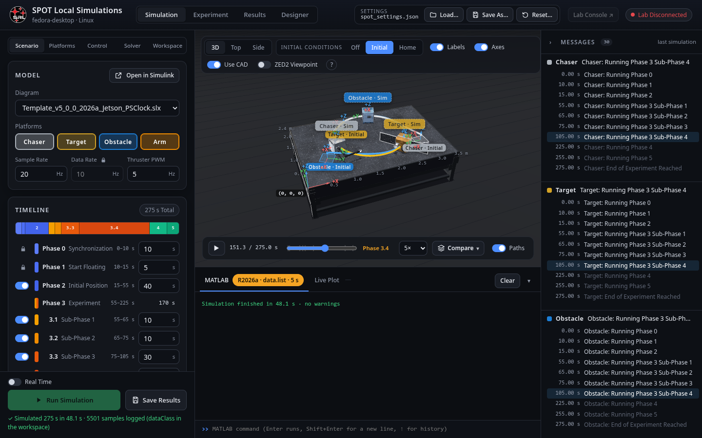

The bar under the 3D view: play/pause (Space), the scrubber, the phase ticks with the phase's name, the speed, and **Paths** (the trails). **Compare ▾** lists the last simulation and every dataset loaded on the Results tab: switch one on to draw it as outlines with dashed paths over the current run, with a **time offset** to line them up; **Load Results…** adds a saved run and **Keep This Simulation** keeps the last run as a dataset when you run again.

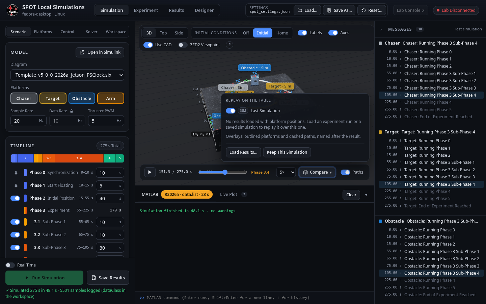

### The 3D view

The toolbar: **3D / Top / Side** cameras, **LED IDs**, **Labels**, **Axes**, **LED Height Lines**, **Use CAD** (the platforms' real shapes, with the Designer's attachments; see [[cad.js|Page-cad-js]]) and the **ZED2 Viewpoint** window (what the Chaser's camera sees, left or right lens or both). The table is 3.5 m × 2.4 m with a 0.5 m grid; the origin is the corner marked with the axes ([[viewer.js|Page-viewer-js]]).

## The MATLAB console and the Live Plot

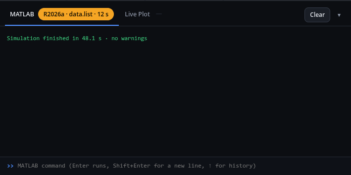

The **MATLAB** tab is a command window into your MATLAB session (history with ↑/↓, `clc`); it is also where the console prints what it did and any error, with buttons that open the offending block in Simulink. The badge shows MATLAB's release and whether it is idle or busy with what. The **Live Plot** tab draws the diagram's [[Live Stream|Diagram-Live-Data-Streams]] blocks: tick a stream, pick its elements, choose the window ([[liveplot.js|Page-liveplot-js]]).

## The Messages panel

Each platform's message (`RED_Logger`, `BLACK_Logger`, `BLUE_Logger`, written by the phases) with the time it changed; during playback the current one is highlighted. In an experiment the same panel shows the platforms' messages as they arrive.

## Reset…

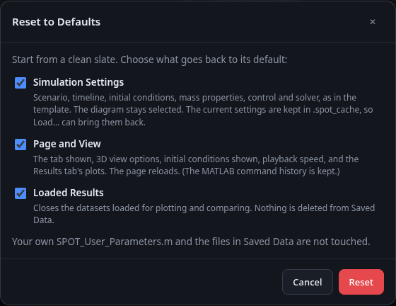

Three independent resets: the **Simulation Settings** to the defaults (a backup of the file is kept and its path shown), the **Loaded Results** (unload every dataset), and the **Page and View** (this browser's remembered tabs, toggles and zooms; the command history is kept).

## Where the values go

Every field maps to a key of `spot_settings.json` ([[Settings File|Settings-File]]); [[spot.params.apply|spot-params-apply]] turns the file into the workspace variables the diagram reads ([[Workspace Variables|Workspace-Variables]]) and back into what this tab displays. Your own variables belong in `SPOT_User_Parameters.m`, which runs after the settings so it can override them.
