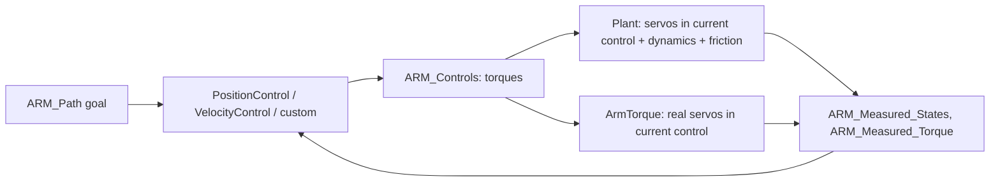

# spot.arm: the simulated arm

`+spot/+arm/` is the Chaser's three-joint arm in simulation, and the controllers that drive it in simulation *and* on the hardware.

The design rule: **the servos are driven by torque, always.** On the hardware the Dynamixel MX-64 servos run in current control ([[spot.hardware.ArmTorque|spot-hardware-ArmTorque]]); in simulation [[Plant|spot-arm-Plant]] simulates them in current control. Position and velocity control are *controllers in the diagram*, [[PositionControl|spot-arm-PositionControl]] and [[VelocityControl|spot-arm-VelocityControl]], which replicate the servos' own control laws (same gains, same units) but output a torque, so exactly the same controller code runs in a simulation and in an experiment; a custom controller is just another block that outputs torques. The maths is on [[The Arm: Dynamics, Friction, Servos|Math-Arm]] and [[Dynamixel Units|Math-Dynamixel-Units]].

| Function | One line |
|---|---|
| [[Plant|spot-arm-Plant]] | the *RED + ARM Plant* block: base + arm dynamics, servos, stick-slip friction, at a 1 ms inner step |
| [[PositionControl|spot-arm-PositionControl]] | the *Default Position Control (ARM)* block: the MX-64's position law → torque |
| [[VelocityControl|spot-arm-VelocityControl]] | the *Default Velocity Control (ARM)* block: the MX-64's velocity law → torque |
| [[withinLimits|spot-arm-withinLimits]] | no torque that pushes a joint further past its position limits |
| [[inertiaMatrix|spot-arm-inertiaMatrix]] | the 6×6 mass matrix of the floating base with the arm |
| [[coriolisMatrix|spot-arm-coriolisMatrix]] | the Coriolis/centripetal matrix |
| [[defaults|spot-arm-defaults]] | the servos' motor, limits, friction and inner step |
| [[parameters|spot-arm-parameters]] | `armModel`: defaults + the settings' geometry and masses + calibration |
| [[loadCalibration|spot-arm-loadCalibration]] | apply an arm calibration (friction, armature): `resources/arm_calibration.json`, the lab's in `resources/spot_calibration.json`, or a struct |
| [[mountGeometry|spot-arm-mountGeometry]] | `Phi`, `b0` and the shoulder's offset for where the arm is mounted |
| [[servoFromDiagram|spot-arm-servoFromDiagram]] | the simulated servos' limits read from the diagram's blocks |
| [[checkCommands|spot-arm-checkCommands]] | warnings after a run: ignored goals, clipped torques |
| [[compareSteps|spot-arm-compareSteps]] | replay the lab's calibration steps through the model and compare |

Tools: `resources/arm_calibration/calibrate_arm.py` ([[page|Tool-calibrate-arm]]) measures the real arm's friction and writes the calibration file.

## Status

The torque-control redesign (2026-10-11) runs at the diagram's 20 Hz with retuned gains. Still to do in the lab: test the new hardware block, run the calibration, and retune the gains against the measured friction.
