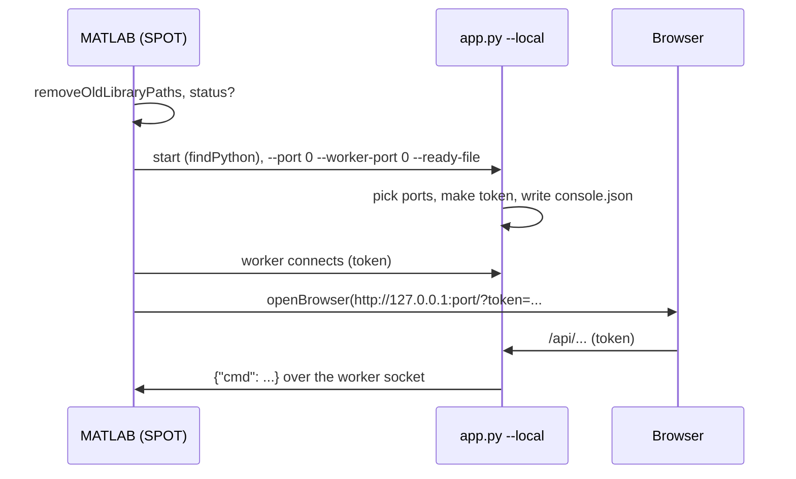

# spot.console: starting the console

`+spot/+console/` is the MATLAB side of starting, opening and stopping the console, and the folder that holds the console itself:

| | |
|---|---|
| `webapp/` | the console: `app.py` starts the server, `spot_console/` is its Python code, `static/` the page. MATLAB starts it with `--local`; the lab console (TX2) runs it as a service. See [[Console Server|Console-Server]] and [[Page|Page-app-js]] |
| `phasespace/` | `StreamData.cc` and its Makefile: the PhaseSpace streamer the lab console compiles and runs ([[page|Hardware-StreamData]]) |
| `deploy/` | `deploy_tx2.sh` (install the lab console on the TX2), `setup_hardware_link.sh` and `spot_agent.sh` (the platforms' side) ([[page|Hardware-Deploy-Scripts]]) |

Run the scripts with a leading `./` (`./+spot/+console/deploy/deploy_tx2.sh`): bash takes a path starting with `+` for an option.

| Function | One line |
|---|---|
| [[start|spot-console-start]] | start the server (or reuse it), connect the worker, open the browser; what `SPOT` does |
| [[open|spot-console-open]] | open the running console in the browser and print its address |
| [[stop|spot-console-stop]] | disconnect the worker and ask the server to shut down |
| [[status|spot-console-status]] | the running console's ports and token from `.spot_cache/console.json`, if it answers |
| [[openBrowser|spot-console-openBrowser]] | open a URL in the default browser (works from a container too) |
| [[findPython|spot-console-findPython]] | a Python 3.6+ to run the server with |
| [[offerPython|spot-console-offerPython]] | when there is none: explain, and offer to install it |
| [[installPython|spot-console-installPython]] | install Python (Windows: winget or python.org's installer; Linux: the package manager) |
| [[ensureShell|spot-console-ensureShell]] | make `system()` work when `$SHELL` isn't a path |
| [[removeOldLibraryPaths|spot-console-removeOldLibraryPaths]] | take the old `Custom_Library` off the path |

