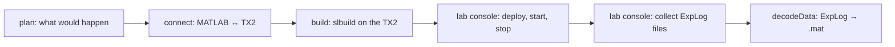

# spot.experiment: building for the platforms

`+spot/+experiment/` is the MATLAB side of the Experiment tab. The build happens **on the lab console** (the Jetson TX2): MATLAB generates the C++ code, copies it there, compiles it with the TX2's own toolchain (so the binary matches the platforms' Jetsons), and the lab console deploys the program to the platforms over the lab network. Afterwards the diagram is exactly as it was: the changes made for the build (plant commented out, fixed-step solver, Jetson board, "Build" not "Build and run") are undone and nothing is saved.

| Function | One line |
|---|---|
| [[plan|spot-experiment-plan]] | the model, board, folders, platforms, changes and warnings, without building |
| [[buildBoard|spot-experiment-buildBoard]] | the TX2's address, user and the folder the build goes in |
| [[connect|spot-experiment-connect]] | connect MATLAB's Jetson support package to the TX2 |
| [[build|spot-experiment-build]] | generate, copy and compile the program for the platforms |
| [[decodeData|spot-experiment-decodeData]] | the platforms' `ExpLog*` logs → `<PLATFORM>_<n>.mat` with `dataClass_rt` |

Needs the MATLAB Coder Support Package for NVIDIA Jetson (`jetson`, `slbuild` with the Jetson target). The lab console's part is in [[experiment.py|Console-experiment]] and the platforms' in [[spot_agent.sh|Hardware-Deploy-Scripts]].
