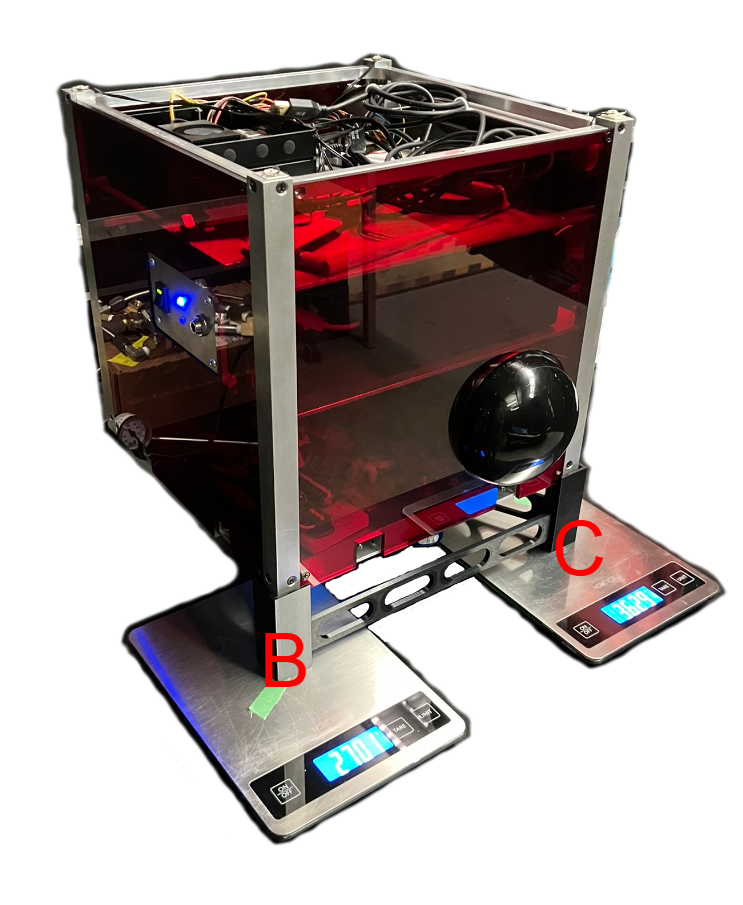
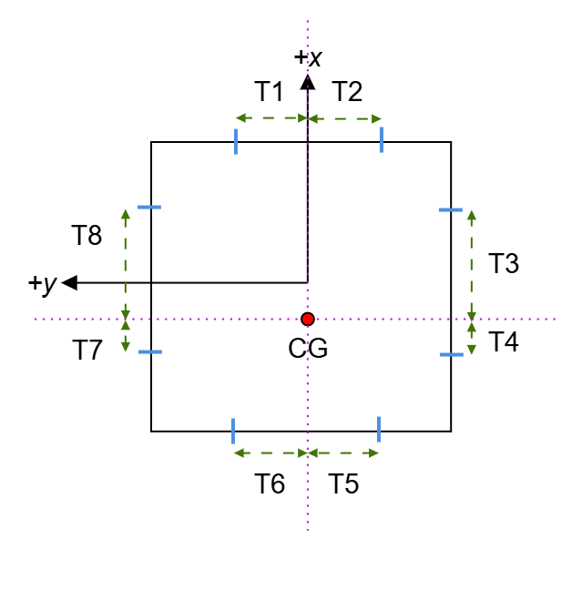

# spot.massprops: mass properties

`+spot/+massprops/` turns the lab's measurements into what the diagram and the PhaseSpace server need: each platform's mass, centre of gravity, inertia, the distance of each thruster's line of action from the CG, and the LED positions for the marker calibration. The arithmetic is on [[Mass Properties|Math-Mass-Properties]].

```matlab
s = spot.params.defaults();
mp = spot.massprops.compute(s.mass);
mp.RED.mass, mp.RED.cg, mp.RED.inertia, mp.RED.thrusters, mp.RED.leds
spot.massprops.writeTrackerPositions(mp, pwd);   % resources/tracker_positions_phasespace.txt
```

| Function | One line |
|---|---|
| [[compute|spot-massprops-compute]] | RED, BLACK and BLUE from the settings' `mass` section (honouring `override`) |
| [[centerOfGravity|spot-massprops-centerOfGravity]] | three scale readings → mass, CG, thruster offsets, LED positions |
| [[bifilarInertia|spot-massprops-bifilarInertia]] | the bifilar pendulum formula |
| [[trackerPositions|spot-massprops-trackerPositions]] | the marker calibration text |
| [[writeTrackerPositions|spot-massprops-writeTrackerPositions]] | write it to `resources/` |




