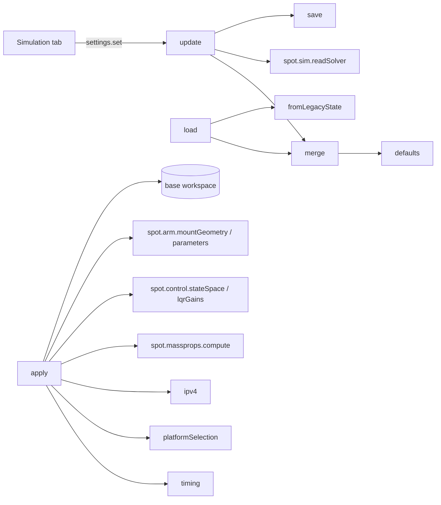

# spot.params: settings

`+spot/+params/` holds everything about the settings struct `s`: where it comes from, how it is saved, and how it becomes the diagram's workspace variables. The console's MATLAB worker calls these for every change on the Simulation tab; you can call them yourself to run a simulation without the console:

```matlab
s = spot.params.load('spot_settings.json');   % or spot.params.defaults()
s.platforms.RED = true;
spot.params.apply(s, pwd);                    % the diagram can now read its variables
out = spot.sim.run(s, pwd);
```

| Function | One line |
|---|---|
| [[defaults|spot-params-defaults]] | the settings the console starts from |
| [[load|spot-params-load]] | read a JSON file (or an old GUI state), filling gaps with the defaults |
| [[save|spot-params-save]] | write the JSON file |
| [[merge|spot-params-merge]] | overlay one struct on another, field by field |
| [[update|spot-params-update]] | what the worker does with settings the page sends |
| [[reset|spot-params-reset]] | back to the defaults, keeping the diagram, with a backup |
| [[timing|spot-params-timing]] | phase durations → end times, total time, the timeline's segments |
| [[platformSelection|spot-params-platformSelection]] | the platforms' on/off switches → the diagram's code 0–11 |
| [[ipv4|spot-params-ipv4]] | `'192.168.1.116'` → `[192 168 1 116]` |
| [[apply|spot-params-apply]] | settings → base workspace (and `SPOT_User_Parameters.m`) |
| [[fromLegacyState|spot-params-fromLegacyState]] | convert a saved state of the old App Designer GUI |

How they fit together:



See also [[The Settings File|Settings-File]] and [[Workspace Variables|Workspace-Variables]].
