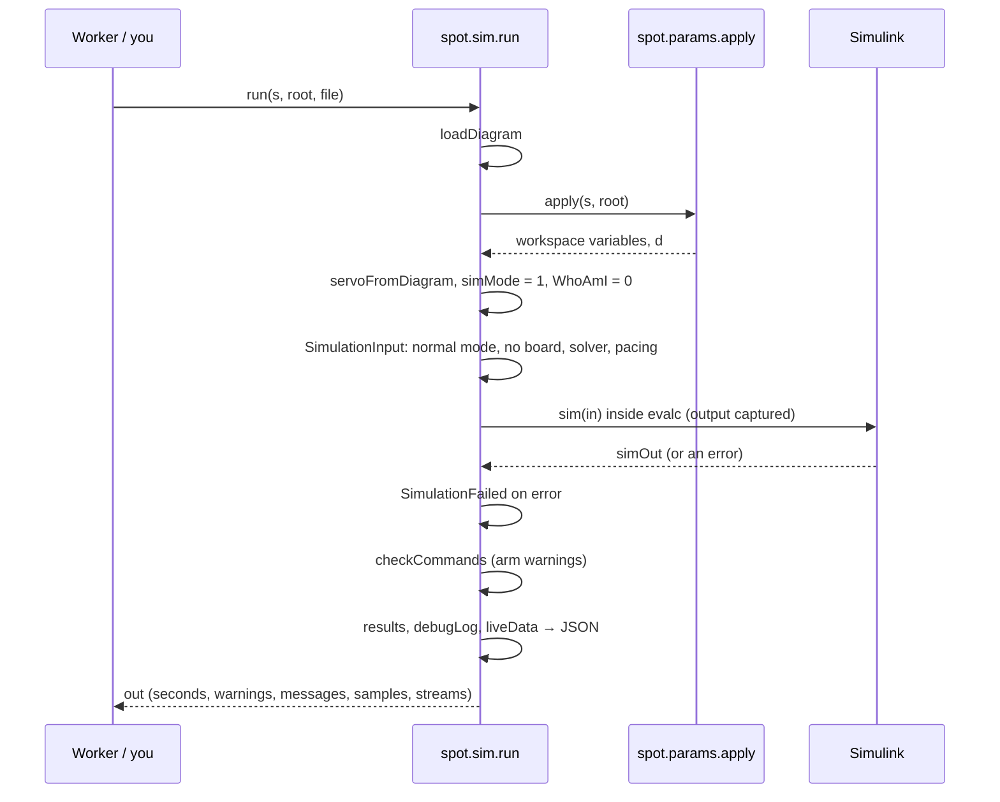

# spot.sim: simulations

`+spot/+sim/` is everything about running the diagram on your computer: finding and loading diagrams, running a simulation with the settings as temporary overrides (the `.slx` file is never modified), capturing Simulink's output, turning errors into something readable, and producing the replay the 3D view shows.

```matlab
s = spot.params.load('spot_settings.json');
out = spot.sim.run(s, pwd);                 % simOut, dataClass, dataPacket appear in the workspace
out = spot.sim.run(s, pwd, 'replay.json');  % also writes the 3D view's trajectory
```

| Function | One line |
|---|---|
| [[listDiagrams|spot-sim-listDiagrams]] | the `.slx` files in the project folder |
| [[modelName|spot-sim-modelName]] | `'X.slx'` → `'X'` |
| [[loadDiagram|spot-sim-loadDiagram]] | load a diagram into memory without opening its window |
| [[readSolver|spot-sim-readSolver]] | copy a diagram's solver settings into the settings struct |
| [[run|spot-sim-run]] | simulate: apply the settings, set the overrides, capture the output, collect results |
| [[results|spot-sim-results]] | the logged data resampled to ≤30 Hz as x, y, θ per platform and the arm's joint points |
| [[liveData|spot-sim-liveData]] | the record of what the Live Stream blocks sent during the run |
| [[debugLog|spot-sim-debugLog]] | the record of the platforms' debug messages during the run |
| [[SimulationFailed|spot-sim-SimulationFailed]] | the error class `run` throws |
| [[errorDetails|spot-sim-errorDetails]] | any error → root cause, chain of causes, blocks named, where in your code |
| [[showBlock|spot-sim-showBlock]] | open the diagram at a block and highlight it |

What a simulation does, in order:


